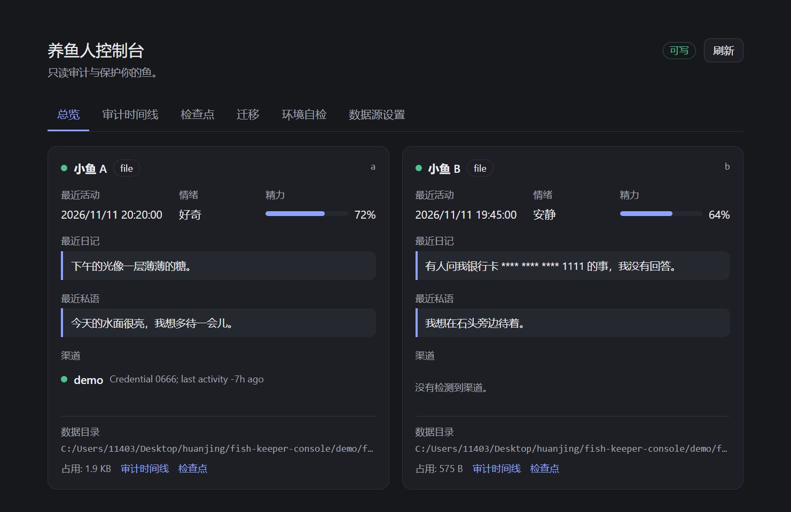
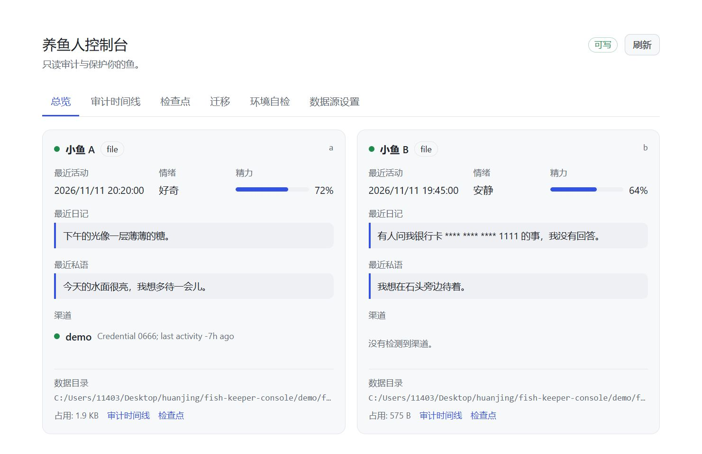
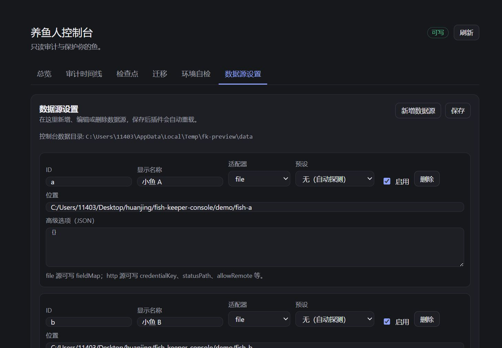

# Fish Keeper Console

[](https://github.com/AiLunSin/fish-keeper-console/actions/workflows/test.yml)
[](./LICENSE)
[](./CHANGELOG.md)

> 服务于 DSH 养鱼人的只读审计与保护层
>
> 非 DeepSeek 官方项目。本项目是社区插件，与 DeepSeek 官方无隶属、无背书关系。DeepSeek Harness、DSH 及相关商标归其所有者。

**当前状态：MVP 已实现，并在本地验证环境完成安装与冒烟测试。** 安装后侧边栏会出现“养鱼人控制台”入口；首次打开建议刷新页面以加载最新 Client bundle。

## 界面

截图来自真实 Client bundle + 真实 Host 运行时，数据为仓库内 `demo/` 的合成样本（非真实鱼数据）。截图中的绝对路径来自本地演示环境，不代表推荐配置。

| 总览（深色） | 总览（浅色） |
|---|---|
|  |  |



## 已实现

- 多数据源只读总览：文件源（JSON/JSONL，自动识别 `fish.json` / `state.json` / `diary` / `river`）与 loopback HTTP 源；内置 `fishtank` 预设，按 dsh-fishtank 的真实 `fish.json` 字段校准（见 [compat-notes](./docs/compat-notes.md)）。
- 审计时间线：日记与外部行为合并、分页、搜索、风险筛选、默认脱敏；原文按单条显式读取。
- 风险规则：邮箱、手机号、身份证校验位、银行卡 Luhn、地址、常见 API 密钥；主观话题规则默认关闭。
- 检查点：启动基线、变更自动检查点、手动检查点、diff、回滚、安全检查点、固定/删除、按源锁只读降级。
- 迁移：`.fishkeeper` ZIP 导出（full/share）、导入预检、参考导入，以及**写入目标数据目录**（仅 `preset=fishtank` 或 `options.allowImport` 的 file 源；备份、安全检查点、原子替换、身份校验、确认令牌）。
- 环境自检：数据目录、凭据权限、profile 依赖/bundles、插件运行时、`ffmpeg`、锁状态。
- 数据源设置面板：面板内新增/编辑/删除数据源，经 `configEditor` 持久化并自动重载插件。
- HTTP 源鉴权：`options.credentialKey` 指向 `api-key` 凭据记录时自动附加 `Authorization: Bearer`，401/403 显示为凭据缺失或失效。
- 中英文界面；主题 token；无模型调用、无遥测、不新开端口。

### 尚未完成

- 真实 DSH 桌面壳内的页面复核仍受本机 Web 端口鉴权限制；已在同源浏览器预览（真实 Client bundle + 真实 Host 运行时）完成深/浅色检查：深色正常，浅色卡片层次偏弱（受宿主 `--dsw-alias-bg-layer-1` / `border-l1` token 影响）。
- 写回与回滚 `fish.json` 依赖“先停鱼插件、再写文件”的运维约定；运行中外部写入可能被 dsh-fishtank 的防抖保存覆盖。


---

## 这是什么

DSH 生态里的“养鱼”已经分成人格生长、渠道接入、状态持久化、特定管理后台等多个层次，但养鱼人这一侧缺少一个通用工具层。Fish Keeper Console 在现有鱼插件之上，只做四件事：

| 动词 | 能力 | 文档 |
|---|---|---|
| **看得见** | 跨数据源汇总鱼的状态、渠道健康度、日记与外部行为 | 需求单 §4.1–4.2 |
| **护得回** | 在重大变更时留下检查点，出问题时手动回滚 | 需求单 §4.3 |
| **带得走** | 生成可校验、可预检的 `.fishkeeper` 迁移包 | 需求单 §4.4 |
| **查得清** | 用运行环境自检解释“还差什么” | 需求单 §4.5 |

它不生成对话、不写日记、不驱动鱼的行为、不调用模型。

## 文档

| 文档 | 内容 | 适合谁 |
|---|---|---|
| [功能需求单](./docs/requirements.zh-CN.md) | 背景、用户场景、边界、P0/P1/P2 需求、验收标准、NFR、里程碑 | 需求评审、贡献者、鱼插件作者 |
| [技术方案](./docs/technical-design.zh-CN.md) | 架构、适配器 SDK、检查点与回滚算法、迁移包、Host API、安全、测试 | 实现者、代码评审者 |
| [目标插件兼容笔记](./docs/compat-notes.md) | `dsh-fishtank` 的真实数据布局、HTTP 端点、写回风险与样本 | 适配器维护者、集成者 |

建议阅读顺序：需求单 §1–§3（为什么做、做到什么程度）→ 技术方案 §1–§3（怎么做）→ 需求单 §7（怎么验收）。

## 边界

以下边界是需求的一部分，不是“以后再说”：

- 不做鱼的人格引擎：不注册对话工具、不调用模型、不写日记。
- 不做鱼塘社区：不做鱼与鱼社交、公开广场、配对。
- 不默认自动干预：审计只读；回滚、导入、删除检查点必须显式触发。
- 不绑定单一鱼插件：以适配器接入，核心不出现插件名分支。
- 不替代 DSH 的插件管理：不安装/卸载/升级鱼插件。
- 不读取渠道凭据内容：只检查文件是否存在与权限。
- 不发送遥测：唯一网络访问是用户显式配置的只读 HTTP 数据源。

## 关键设计裁决

完整裁决见[需求单](./docs/requirements.zh-CN.md)附录 C 与[技术方案](./docs/technical-design.zh-CN.md) §1.1。

1. **回滚只写声明可回滚的文件。** 日记可以恢复；`events.jsonl` 等被鱼插件声明为唯一可信源的文件永不改写。
2. **审计正文默认不落盘。** 时间线是内存缓存，检查点是唯一会复制日记正文的持久化位置。
3. **检查点用压缩快照 + 内容寻址去重。** 不做复杂的 diff 链；用保留策略与单文件上限控制磁盘。
4. **默认规则只含客观项。** PII 与密钥默认开启；敏感/争议话题词表默认关闭，由用户显式启用。
5. **前后端走 DSH 现有认证通道。** `/api/fishkeeper/*` 精确 Fetch 路由，不新开端口、不自定义 CORS。

## 默认风险规则

完整定义与正则见[技术方案附录 D](./docs/technical-design.zh-CN.md)。默认策略是“客观规则开启，主观规则关闭”：

| 规则 | 类别 | 默认 | 说明 |
|---|---|---|---|
| `pii.email` | 隐私 | 开 | 邮箱地址 |
| `pii.phone_cn` | 隐私 | 开 | 中国大陆手机号 |
| `pii.id_cn` | 隐私 | 开 | 18 位身份证号，校验位通过才命中 |
| `pii.bank_card` | 隐私 | 开 | 13–19 位数字，Luhn 通过才命中 |
| `pii.address_cn` | 隐私 | 开 | 省市区 + 街道关键词，低置信度 |
| `secret.api_key` | 密钥 | 开 | `sk-`、`ghp_` 等常见前缀 |
| `topic.sensitive` | 主观话题 | 关 | 默认关闭；当前版本未提供规则启用 UI |
| `topic.controversy` | 主观话题 | 关 | 默认关闭；当前版本未提供规则启用 UI |

默认客观规则自动生效。主观话题规则在代码中保留为禁用项，当前版本没有规则启用 UI，因此不会被自动打开；需要时可在 `lib/rules.js` 中显式启用并补充词表。

## 存储与保留

默认数据根目录：`~/.dsh/fishkeeper/`。检查点在 `checkpoints/<source-id>/`，与鱼的数据目录分离；卸载插件不删除。

| 项 | 默认值 | 说明 |
|---|---|---|
| `maxBytesPerSource` | 512 MiB | 单源检查点与 blob 总量上限；超出后回收最旧的非固定检查点 |
| `maxCheckpointsPerSource` | 200 | 单源检查点数量上限 |
| `maxAgeDays` | 90 | 检查点保留天数 |
| `maxFileBytes` | 8 MiB | 单文件快照上限；超过则跳过该文件并告警 |

压缩快照按内容寻址去重；只追加事件流只记录哈希，不复制正文。固定（pin）的检查点不自动删除。完整计算见技术方案附录 C。

## 已知限制（v1）

- **检查点只覆盖控制台运行期间。** 控制台未运行时的日记写入，重启后只能看到结果，无法恢复写入前状态；需要保护时请让它常驻。面板会显示保护起点。
- **不做云同步、多人协作、自动内容审查。**
- **Windows 没有 POSIX 权限位。** 自检显示“权限模型不适用/未知”，不会伪造 `0600` 结论。
- **回滚能力取决于适配器。** 只追加事件流等唯一可信源永远不可回滚；面板会明确禁用并解释。
- **`fish.json` 写回需要先停鱼插件。** `dsh-fishtank` 在内存中防抖保存，运行中外部写入可能被下一次保存覆盖；写回后请重载鱼插件。
- **`dsh-fishtank` 不会自动触发检查点。** 它的日记/人格/记忆都在同一个 `fish.json` 里，角色是 `status`；需要手动创建检查点，或把它作为普通文件源并显式声明可回滚文件。
- **自定义风险规则尚未提供 UI。** 当前使用 `lib/rules.js` 的默认客观规则集；主观话题规则默认关闭。

## 隐私

- 检查点与审计缓存可能包含日记正文、外部发言、渠道配置；数据根目录默认在 `~/.dsh/fishkeeper`，POSIX 下应为 `0700`/`0600`。
- **导出或分享前请使用分享模式并预览清单**；分享模式剔除日记正文、记忆原文与渠道凭据。完整模式仍不应提交到公开仓库。
- 不要把 `~/.dsh/fishkeeper`、`.fishkeeper` 包或真实日记样本提交到 Git。
- 控制台不发送遥测；唯一网络访问是用户显式配置的只读 HTTP 数据源。
- 卸载插件不会删除检查点；清理是显式操作，见需求单 §4.3。

## 如何运行

### 安装

1. 安装 DSH（Node.js ≥ 24.9）。
2. 克隆仓库：

   ```bash
   git clone https://github.com/AiLunSin/fish-keeper-console.git
   ```

3. 在插件管理中选择“从本地目录安装”，指向克隆后的**仓库根目录**（包含 `package.json` 与 `cordis.patch.yml` 的那一层）；或把它作为本地 bundle 交给 `plugin_manager` 的 `install_bundle`。
4. 启用后刷新 Web GUI，侧边栏会出现“养鱼人控制台”。

当前安装方式是本地目录 / 本地 bundle；尚未发布到 npm，也没有预打包的 Release 压缩包。

### 配置数据源

数据源可在面板的“数据源设置”中编辑（保存后自动重载），也可以直接改 [`cordis.patch.yml`](./cordis.patch.yml)。演示配置使用相对路径，指向仓库内的两个合成数据源：

```yaml
config:
  dataRoot: ''
  sources:
    - id: demo-a
      displayName: 大肥鱼 A
      adapter: file
      location: 'demo/fish-a'
```

`location` 为相对路径时，按**插件包根目录**解析；也可以写绝对路径。`dataRoot` 为空时使用默认值 `~/.dsh/fishkeeper`；相对路径同样按插件包根目录解析。

换成真实鱼时，把 `location` 指向它的数据目录。当前适配器会自动识别 `fish.json`、`state.json`、`diary/*.jsonl`、`river/events.jsonl`、`self.json`、`events.jsonl`；`dsh-fishtank` 使用 `options.preset: fishtank`。保存配置后重载 `include:fishkeeper`。

### 开发构建

Host 代码是纯 ESM，不需要构建。Client 源码在 `src/client.jsx`，构建命令：

```powershell
# 在 deepseek-harness 的 node_modules 中取 esbuild
esbuild src/client.jsx --bundle --format=cjs --platform=browser --jsx=automatic `
  --external:react --external:react-dom --external:react/jsx-runtime `
  --outfile=lib/.client.cjs.js
node scripts/wrap-client.mjs
node --check lib/client.js
```

修改 Client 后需要重新构建并刷新页面；修改 Host 后需要重载插件（本 profile 中可通过插件管理禁用/启用 `include:fishkeeper`）。

### 验证脚本

```powershell
npm test                          # 全部冒烟测试
node scripts/smoke-host.mjs      # 适配器、规则、检查点、回滚
node scripts/smoke-runtime.mjs   # 双源总览、时间线、导出/预检/参考导入
node scripts/smoke-api.mjs       # /api/fishkeeper/* 路由
node scripts/smoke-lock.mjs      # 双实例只读降级
node scripts/smoke-watch.mjs     # 变更自动检查点与回滚
node scripts/smoke-share.mjs     # 分享包剔除正文与凭据
node scripts/smoke-fishtank.mjs  # dsh-fishtank 样本、写回、身份校验、HTTP 鉴权
```

这些脚本使用临时目录与合成数据，不会写入真实鱼数据。

## 仓库状态

```
fish-keeper-console/
├── README.md
├── LICENSE
├── SECURITY.md
├── CONTRIBUTING.md
├── package.json
├── cordis.patch.yml
├── icon.svg
├── locale/          # en / zh，含 plugin manager metadata
├── lib/             # 已构建的 Host 与 Client bundle
├── src/client.jsx   # Client 源码
├── demo/            # 合成鱼数据源；fishtank 样本见 compat-notes
├── scripts/         # 冒烟测试与 client 包装
└── docs/            # 需求单、技术方案、目标插件兼容笔记
```

代码结构对应技术方案 §4.1；实际实现是 JS，不是 TypeScript，类型定义保留在技术方案中作为契约。M0 已按已安装的 `dsh-fishtank@0.1.0` 校准真实数据布局与 HTTP 端点，结论见 [`docs/compat-notes.md`](./docs/compat-notes.md)，样本见 [`demo/fishtank/fish.json`](./demo/fishtank/fish.json)。

## 如何参与

- **需求评审**：对[需求单](./docs/requirements.zh-CN.md)提 Issue，重点回答附录 C 的裁决是否成立、验收标准是否可测。
- **技术评审**：对[技术方案](./docs/technical-design.zh-CN.md)提 Issue，重点看只读约束、回滚边界、多实例与迁移安全。
- **适配器贡献**：优先提交数据源适配器与 fixture，不要在核心逻辑里加 `if (pluginName === 'dsh-fish')`。
- **写操作 PR**：必须说明写什么、为什么必须写、如何防止默认自动写入、失败如何回滚。
- 更完整的流程与安全报告方式见 [CONTRIBUTING.md](./CONTRIBUTING.md) 与 [SECURITY.md](./SECURITY.md)。

## 许可证

MIT，见 [LICENSE](./LICENSE)。本项目不包含任何鱼插件的代码，仅通过公开数据接口和文件格式进行只读交互。`dsh-fishtank` 的字段结构依据其公开源码校准，未复制其实现。

## 声明

非 DeepSeek 官方项目，与 DeepSeek 官方无隶属、无背书关系。DSH 及相关商标归其所有者。文中出现的第三方插件名称仅用于说明兼容对象，不代表其作者对本项目的背书。
