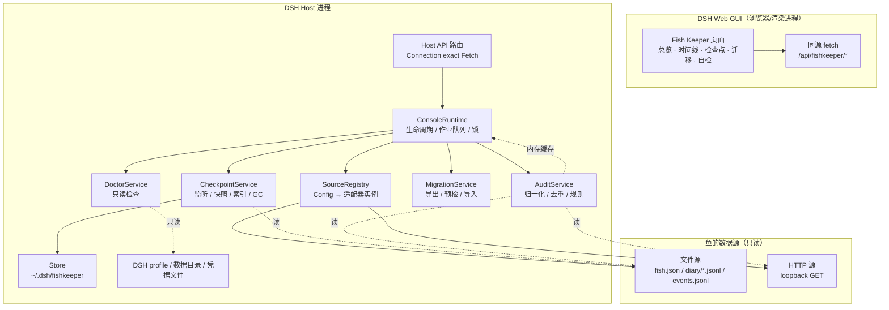
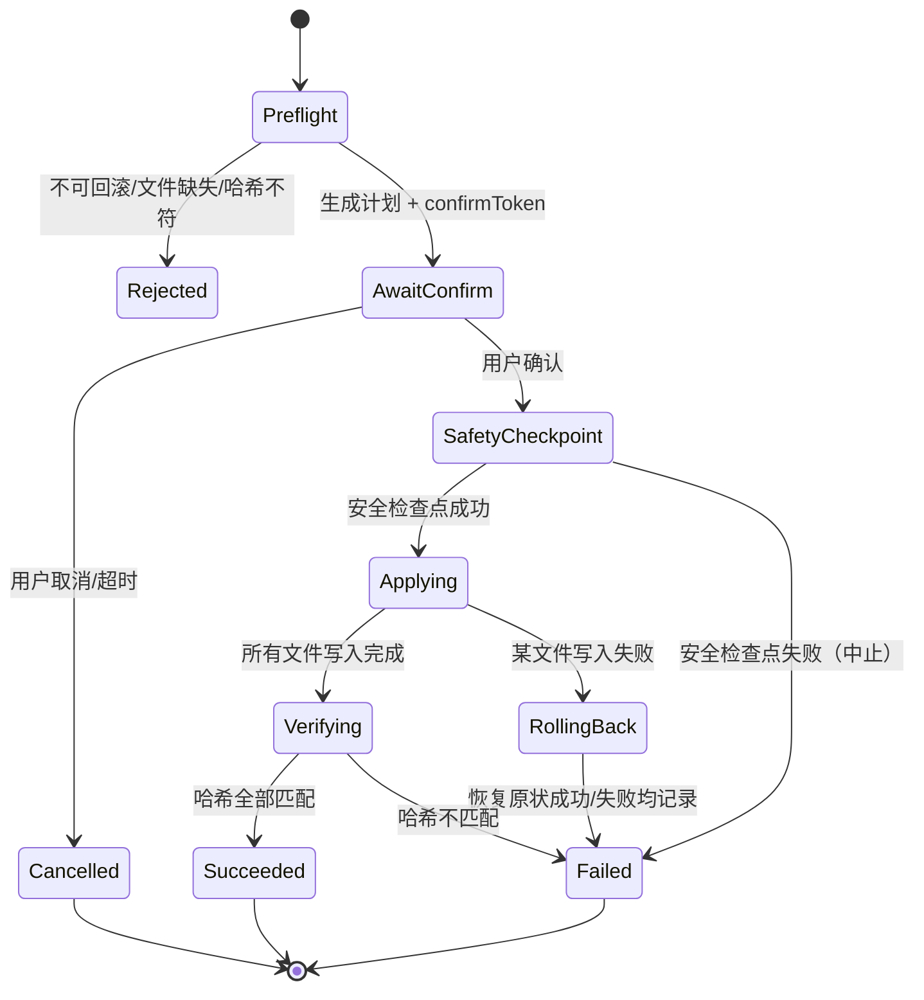

# Fish Keeper Console · 技术方案

> 与[功能需求单](./requirements.zh-CN.md)配套的实现设计。本文描述 v1.0 的架构、模块边界、数据格式、关键算法、安全约束与测试策略。

| 项目 | 内容 |
|---|---|
| 文档版本 | v0.1（Draft） |
| 文档状态 | 待评审；与需求单同步冻结 |
| 更新日期 | 2026-11-11 |
| 目标运行时 | DeepSeek Harness（DSH）Web / Desktop，Node.js ≥ 24.9 |
| 目标包 | `dsh-fishkeeper`（Cordis bundle + Web Client 插件） |
| 关联需求 | [requirements.zh-CN.md](./requirements.zh-CN.md) |

> **实现状态**：本文是设计基线。当前 MVP 已实现双源总览、审计、检查点/回滚、`dsh-fishtank` 写回、HTTP 鉴权、数据源设置与自检；实现为纯 JavaScript，不是 TypeScript。与本文的差异见根目录 [README](../README.md) 的“已实现/尚未完成”。

**阅读路径**：实现者先读 §3–§8（架构、适配器、存储、检查点）；评审者重点看 §1.1、§8.5、§15、§17；维护者看 §18–§20。关键需求裁决与技术实现的对应关系见文末附录 E。

---

## 1. 设计摘要

Fish Keeper Console 是一个**双半插件**：

- **Host 半**运行在 DSH 主进程内，负责读取数据源、维护检查点、执行回滚与导入导出、提供自检。它不注册模型工具、不调用模型、不写鱼的数据（显式回滚除外）。
- **Client 半**运行在 DSH Web GUI 的浏览器/渲染进程内，注册一个侧边栏入口和一个主面板，负责展示与确认交互。它不直接读文件，只调用 Host 暴露的认证 API。

两者通过 DSH 现有的 **Connection 认证通道**通信：Host 在 `/api` 下注册精确 Fetch 路由，Client 用同源 `fetch('/api/fishkeeper/...')` 调用。这样不需要新开端口、不需要自定义 CORS，也同时覆盖 Web 与 Desktop 的传输。

核心模块：

```
数据源适配器（只读）
   ├── file：声明式字段映射 + 受跟踪文件清单
   ├── http：loopback 只读 GET
   └── mock：测试夹具
检查点引擎（读源 + 写自己的存储）
审计引擎（读源 + 内存缓存 + 规则匹配）
迁移引擎（导出/导入 + 预检 + 事务）
自检引擎（只读探测 profile/目录/凭据/外部依赖）
Host API（认证路由 + 作业队列）
Web Client（总览/时间线/检查点/迁移/自检）
```

### 1.1 关键设计裁决

| 编号 | 裁决 | 对应需求裁决 |
|---|---|---|
| TD-01 | 检查点使用**压缩全量快照 + 内容寻址去重**，不做 diff 链；diff 仅用于预览 | D-03 |
| TD-02 | 审计时间线**不持久化正文**，只做内存缓存；检查点是唯一会复制日记正文的持久化位置 | D-04 |
| TD-03 | 数据源配置以插件 `Config` 为唯一真源；面板编辑走 `configEditor`，保存后插件重载 | D-05 |
| TD-04 | 前后端走 `/api/fishkeeper/*` 精确 Fetch 路由，不新开端口、不用 `webServer` 裸路由 | D-06 |
| TD-05 | 每个数据源独立目录、独立锁、独立检查点；同一源单写者，后进者只读降级 | D-07 |
| TD-06 | 回滚只写适配器声明的 `restorable` 文件；`events.jsonl` 等声明为唯一可信源的文件永不写 | D-01 |
| TD-07 | 不使用 `ctx.fs` 读取鱼数据；Host 直接用 `node:fs/promises`，因为 `ctx.fs` 可能是工作区沙箱作用域 | 安全与路径约束 |
| TD-08 | 不使用 SQLite；索引为追加式 JSONL + 启动扫描修复，避免原生依赖与多进程写锁 | 可移植性 |
| TD-09 | 前端不使用 iframe、不加载其他插件组件；用 React + 主题 token 自绘 | DSH UI 规范 |
| TD-10 | 分享模式采用白名单字段，不做“黑名单过滤后希望没漏” | D-08 |

### 1.2 不做什么（技术层面）

- 不注册 `ctx.tools`、不注册对话节点、不监听 `agent/*` 事件。
- 不导入 `@deepseek-ai/dsh-llm-*`、不调用 `ctx.llm`、不发网络请求给模型。
- 不修改鱼插件、不写 `cordis.patch.yml`、不替用户安装依赖。
- 不监听整个数据目录；只监听适配器声明的受跟踪文件。

---

## 2. 约束与设计驱动

| 约束 | 来源 | 设计后果 |
|---|---|---|
| Host 插件在 DSH 主进程内运行，拥有当前用户权限 | DSH 插件模型 | 不是安全沙箱；必须用路径校验、显式配置、最小写面来控制风险 |
| Client 插件只能通过已认证通道访问 Host | DSH Connection | 使用 `/api` 下的精确 Fetch 路由；不新开监听端口 |
| 插件可能被禁用/重载/HMR | Cordis 生命周期 | 所有 watcher/timer/route/lock 必须在 `ctx.effect` 中取得并释放 |
| 鱼插件的数据格式不在本仓库控制内 | 生态事实 | 适配器与声明式预设；M0 采集真实样本；核心不出现插件名分支 |
| 多实例可能同时运行 | 用户可能开两个 DSH | 每源文件锁 + 心跳；后进者只读 |
| 日记可能很大、更新频繁 | 真实使用 | 增量 tail、扫描上限、分页、压缩快照、保留策略 |
| Windows 没有 POSIX 权限位 | 跨平台 | 自检显示“不适用/未知”；不以 `0600` 作为 Windows 结论 |
| DSH API 处于 pre-stable | 生态阶段 | 锁定 peer 范围；可选服务用 `ctx.get`；集成测试覆盖当前稳定版 |

---

## 3. 总体架构

### 3.1 组件图



### 3.2 进程与线程模型

- **单进程、单事件循环**。所有 I/O 异步；哈希与大文件解析使用流式读取，避免一次性 `readFile` 超过上限的文件。
- **CPU 密集操作**（大文件哈希、diff、ZIP 压缩/解压）在 `node:worker_threads` 中执行，避免阻塞 DSH 主循环；worker 由 `ConsoleRuntime` 持有，卸载时 `terminate()`。若目标平台无法使用 worker，回退到主线程的流式实现，并在诊断信息中记录性能告警。
- **作业队列**：导出、导入、批量回滚是长任务，统一走 `JobQueue`（内存 + 串行执行），API 返回 `jobId`，Client 轮询 `/job?id=...`。同一数据源的写操作串行化。
- **无子进程**：自检的 `ffmpeg` 只解析可执行文件路径，不执行；ZIP 用纯 JS 库。

### 3.3 数据流

**读取总览**

1. Client `GET /api/fishkeeper/overview`。
2. Host 对每个启用的数据源调用 `adapter.readStatus()`，3 秒超时，失败隔离。
3. Host 返回脱敏后的摘要；Client 渲染卡片。
4. 无写入。

**读取时间线**

1. Client `GET /api/fishkeeper/timeline?source=&cursor=&limit=50&q=&risk=`。
2. Host 调 `adapter.readDiary/readExternalEvents`，归一化、去重、排序、过滤。
3. Host 对当前页做规则匹配，返回 `textMasked` 与 `hits`；原文只在 `GET /entry?id=...&reveal=1` 时返回。
4. 内存缓存按 `(sourceId, fileVersion)` 失效。

**创建检查点**

1. Watcher/对账发现受跟踪文件变化。
2. 读取变化文件，计算哈希；若与上次记录不同且角色属于触发器，进入检查点流程。
3. 写入压缩 blob（内容寻址）、manifest、索引；全程不写源目录。

**回滚**

1. Client 请求预检 → Host 返回计划与确认 token。
2. Client 二次确认 → Host 先为当前状态创建安全检查点。
3. Host 逐文件写临时文件、fsync、原子替换、校验哈希。
4. 任一步失败 → 尝试从安全检查点恢复；返回逐文件结果。

---

## 4. 插件形态与构建

### 4.1 包布局

```
fish-keeper-console/
├── package.json
├── cordis.patch.yml
├── icon.svg
├── locale/
│   ├── en.json
│   └── zh.json
├── src/
│   ├── host/
│   │   ├── index.ts              # apply + Config + 装配
│   │   ├── runtime.ts            # ConsoleRuntime：生命周期、作业、锁
│   │   ├── api/routes.ts         # /api/fishkeeper/*
│   │   ├── sources/
│   │   │   ├── types.ts
│   │   │   ├── registry.ts
│   │   │   ├── read-only-fs.ts
│   │   │   ├── file/adapter.ts
│   │   │   ├── file/presets.ts
│   │   │   ├── http/adapter.ts
│   │   │   └── mock/adapter.ts
│   │   ├── audit/
│   │   │   ├── timeline.ts
│   │   │   ├── normalize.ts
│   │   │   └── rules/
│   │   ├── checkpoints/
│   │   │   ├── service.ts
│   │   │   ├── manifest.ts
│   │   │   ├── watcher.ts
│   │   │   ├── store.ts
│   │   │   ├── restore.ts
│   │   │   └── lock.ts
│   │   ├── migrate/
│   │   │   ├── package.ts
│   │   │   ├── preflight.ts
│   │   │   └── import.ts
│   │   ├── doctor/
│   │   └── util/
│   ├── client/
│   │   ├── index.tsx             # __ModuleLoader__ 入口
│   │   ├── apply.tsx             # slots 注册
│   │   ├── page/…
│   │   ├── api.ts
│   │   └── locales.ts
│   └── shared/
│       ├── types.ts
│       └── schemas.ts
├── tests/
│   ├── fixtures/
│   ├── unit/
│   ├── contract/
│   ├── integration/
│   └── ui/
├── scripts/
│   ├── build-host.mjs
│   └── build-client.mjs
└── docs/
```

### 4.2 清单与安装

`package.json` 关键字段：

```json
{
  "name": "dsh-fishkeeper",
  "version": "0.1.0",
  "type": "module",
  "exports": {
    ".": "./lib/index.js",
    "./client": "./lib/client.js",
    "./locale/*.json": "./locale/*.json",
    "./icon": "./icon.svg"
  },
  "files": ["lib", "cordis.patch.yml", "locale", "icon.svg", "README.md", "LICENSE"],
  "dsh": {
    "bundle": { "patch": "./cordis.patch.yml" },
    "client": { "platform": "web", "inject": [] }
  },
  "peerDependencies": {
    "@deepseek-ai/cordis": "^<current>",
    "@deepseek-ai/schemastery": "^<current>"
  }
}
```

> 清单中的 `<current>` 是设计占位符；发布脚本必须替换为实际兼容范围，源码与打包产物中不得保留占位符。

`cordis.patch.yml`：

```yaml
- insert:
    - id: fishkeeper
      name: dsh-fishkeeper
      config:
        dataRoot: ''
        sources: []
```

- Host 行由 patch 插入；Client 由 `dsh.client` 自动发现并提供 `./client` 资源。
- 不写用户的 `cordis.patch.yml`；插件自己的配置变更通过 `configEditor`。
- 安装方式：本地目录 bundle 或 npm 包；v1 不自动安装依赖，README 说明。

### 4.3 构建

- **Host**：`esbuild`（或 `tsdown`），`platform: 'node'`，`format: 'esm'`，`target: 'node24'`，bundle 运行依赖，外部化 `@deepseek-ai/*` 类型包。
- **Client**：`esbuild`，`platform: 'browser'`，`format: 'cjs'`，外部化 `react`、`react-dom`、`react/jsx-runtime`；输出再包一层 DSH 动态模块壳：

```js
window.__ModuleLoader__.load({
  id: 'dsh-fishkeeper',
  factory(require) {
    const module = { exports: {} };
    (function (module, exports, require) {
      /* esbuild CJS bundle */
    })(module, module.exports, require);
    return module.exports;
  },
});
```

- Client bundle 的 `id` 必须等于包名；`factory` 返回 `{ inject, apply }`。
- 构建后跑一个冒烟脚本：在 jsdom 中加载 bundle，断言 `apply` 是函数、注册了两个 slot。
- 类型检查用 `tsc --noEmit`；不把 React 类型带进 Host 编译面。
- 运行依赖保持最小：设计阶段考虑 `fflate`（ZIP）、`semver`（兼容性）、`safe-regex2`（规则校验）；当前 MVP 使用内置 store-only ZIP、轻量版本比较和静态安全规则，因此插件本身没有第三方运行依赖。不引入 SQLite、原生模块或任何 LLM SDK。`react`/`react-dom` 由 DSH 模块表提供。

### 4.4 Config 设计

使用 `@deepseek-ai/schemastery` 的 `z`：

```ts
import z from '@deepseek-ai/schemastery'

export const Config = z.object({
  dataRoot: z.string().default(''),
  sources: z.array(z.object({
    id: z.string().required(),
    displayName: z.string().required(),
    // 适配器名在 SourceRegistry 中校验，避免 Config 层绑死可用适配器集合
    adapter: z.string().required(),
    location: z.string().required(),
    enabled: z.boolean().default(true),
    options: z.any().default({}),
  })).default([]),
  retention: z.object({
    maxCheckpointsPerSource: z.number().default(200),
    maxAgeDays: z.number().default(90),
    maxBytesPerSource: z.number().default(512 * 1024 * 1024),
    maxFileBytes: z.number().default(8 * 1024 * 1024),
  }).default({}),
  http: z.object({
    timeoutMs: z.number().default(3000),
    maxResponseBytes: z.number().default(4 * 1024 * 1024),
    allowRemote: z.boolean().default(false),
  }).default({}),
  scan: z.object({
    maxEntries: z.number().default(50000),
    maxBytes: z.number().default(64 * 1024 * 1024),
    pageSize: z.number().default(50),
  }).default({}),
  rules: z.object({
    packs: z.array(z.string()).default(['default']),
  }).default({}),
})
```

- `dataRoot` 为空时解析为 `~/.dsh/fishkeeper`。
- `@deepseek-ai/schemastery` 由 DSH 提供；在 `peerDependencies` 中声明，或随包打包但只用于本插件 Config 校验，避免与宿主 schema 实例混用。
- 密钥不进入 Config；HTTP 数据源的 token 存 `ctx.credentials`。
- 面板编辑数据源时，Host 调 `ctx.get('configEditor')?.edit(entry, ...)`；保存成功后插件按 Loader 语义重载，Client 显示“配置已保存，正在重连”。
- `configEditor` 需要 `ctx.fiber.entry`；若 entry 不存在（测试装配或嵌套插件），返回 `fishkeeper/config-unavailable`，并提示用户手动编辑 `cordis.patch.yml`。插件绝不自己改写该文件。

---

## 5. 数据源适配器 SDK

### 5.1 接口

```ts
export type SourceId = string
export type JsonValue = string | number | boolean | null | JsonValue[] | { [k: string]: JsonValue }

export interface SourceConfig {
  id: SourceId
  displayName: string
  adapter: string
  location: string
  enabled: boolean
  options: Record<string, JsonValue>
}

export interface SourceCapabilities {
  status: boolean
  diary: boolean
  externalEvents: boolean
  checkpoint: boolean
  restore: boolean
  import: boolean
}

export type TrackedRole = 'status' | 'diary' | 'persona' | 'memory' | 'events' | 'external' | 'other'

export interface TrackedFile {
  role: TrackedRole
  /** 相对数据源根目录的 POSIX 路径；配置中的 glob 由适配器展开为具体文件 */
  path: string
  format: 'json' | 'jsonl' | 'text' | 'binary'
  /** 是否允许回滚；默认 false */
  restorable: boolean
  /** 只追加文件：只记录哈希与大小，永不回滚 */
  appendOnly?: boolean
}

export interface SourceDescription {
  id: SourceId
  adapter: string
  displayName: string
  root?: string
  plugin?: { name: string; version?: string }
  capabilities: SourceCapabilities
  files: TrackedFile[]
  warnings: string[]
}

export interface ReadRange {
  from?: string
  to?: string
  cursor?: string
  limit: number
}

export interface Page<T> {
  items: T[]
  nextCursor?: string
  truncated?: boolean
}

/** 适配器声明“这些相对路径可以一起取一致快照”；文件适配器由检查点引擎直接读，不需要实现。 */
export interface SnapshotPlan {
  files: string[]
}

export interface SourceAdapter {
  readonly kind: string
  describe(signal: AbortSignal): Promise<SourceDescription>
  readStatus(signal: AbortSignal): Promise<FishStatus>
  readDiary?(range: ReadRange, signal: AbortSignal): Promise<Page<DiaryEntry>>
  readExternalEvents?(range: ReadRange, signal: AbortSignal): Promise<Page<ExternalEvent>>
  /** 可选：适配器自己产生一致快照；文件适配器不需要，由检查点引擎直接读文件 */
  snapshot?(targets: readonly string[], signal: AbortSignal): Promise<SnapshotPlan>
  restore?(plan: RestorePlan, signal: AbortSignal): Promise<RestoreResult>
  import?(stagingDir: string, signal: AbortSignal): Promise<ImportResult>
}
```

### 5.2 能力协商

- `describe()` 是唯一的能力来源。面板只展示适配器声明支持的功能。
- `restore` 必须同时满足：`capabilities.restore === true`、目标文件 `restorable === true`、`appendOnly !== true`、源未被只读降级。四个条件缺一不可。需求单中的 `restore(target, checkpoint)` 在实现中收敛为 `restore(plan)`：plan 携带目标文件、确认令牌与 stale 覆盖标记，避免适配器各自解释“回滚什么”。
- `describe()` 失败时，数据源进入 `error` 状态，其他源不受影响。
- 适配器版本变化导致能力变化时，面板显示“数据源能力已变化”，要求用户重新确认触发器。

### 5.3 只读约束的实现

适配器不直接拿 `node:fs`，而是拿一个窄接口：

```ts
export interface ReadOnlySourceFs {
  stat(relPath: string, signal?: AbortSignal): Promise<{
    type: 'file' | 'directory'
    size: number
    mtimeMs: number
    mode?: number
  } | undefined>
  readBytes(relPath: string, maxBytes: number, signal?: AbortSignal): Promise<Uint8Array>
  readText(relPath: string, maxBytes: number, signal?: AbortSignal): Promise<string>
  list(relPath: string, signal?: AbortSignal): Promise<Array<{ name: string; type: 'file' | 'directory' }>>
  hash(relPath: string, signal?: AbortSignal): Promise<string>
  /** 解析后的绝对路径，仅用于展示与错误信息 */
  absolute(relPath: string): string
}
```

实现要点：

1. 所有 `relPath` 先过 `resolveWithinRoot(root, relPath)`：拒绝绝对路径、`..`、NUL、Windows 保留名；解析 `realpath` 后再次确认仍在根内。
2. 默认不跟随符号链接；`realpath` 后越界即拒绝。
3. 读文件用 `fs.open(path, 'r')` + 流式读取；读取上限由调用方传入。
4. 写能力不在这个接口上。代码层面用 ESLint `no-restricted-imports` 禁止 `sources/**` 导入 `node:fs/promises` 的写函数；只有 `checkpoints/store.ts`、`checkpoints/restore.ts`、`migrate/*`、`util/atomic.ts` 可以写。
5. 契约测试用“哨兵文件系统”：包装真实 fs，任何 `writeFile`/`rename`/`unlink`/`mkdir`/`open('w')` 调用都抛错；对每个适配器跑完整读取流程，断言零写调用。

> 说明：这是**代码纪律 + 测试约束**，不是内核级沙箱。Host 插件拥有用户权限，恶意适配器仍可直接 `import 'node:fs'`。因此适配器需要代码评审；v1 只内置适配器，第三方适配器以 PR 形式进入仓库。

### 5.4 文件适配器

文件适配器是**声明式**的：预设只提供默认映射，核心不写插件分支。

```json
{
  "id": "fish-a",
  "displayName": "大肥鱼 A",
  "adapter": "file",
  "location": "C:/Users/me/.dsh/fish/fish-a",
  "options": {
    "preset": "fishtank",
    "status": { "path": "fish.json", "format": "json" },
    "diary": { "path": "diary/*.jsonl", "format": "jsonl" },
    "external": { "path": "river/events.jsonl", "format": "jsonl", "restorable": false },
    "persona": { "path": "self.json", "format": "json", "restorable": true },
    "memory": { "path": "events.jsonl", "format": "jsonl", "restorable": false, "appendOnly": true },
    "fieldMap": {
      "status.updatedAt": "updatedAt",
      "status.mood": "mood",
      "status.energy": "energy",
      "diary.time": "ts",
      "diary.text": "content",
      "diary.visibility": "visibility"
    }
  }
}
```

- `preset` 只是 `presets.ts` 里的一张映射表；未知字段由 `fieldMap` 覆盖。
- 渠道健康度配置在 `options.channels`：渠道名、凭据文件相对路径、最近活动的字段/文件、可选健康端点。文件适配器只 `stat` 凭据文件，不读取内容；HTTP 适配器可以 `GET` 一个只读健康端点，失败降级为 `unknown`。
- “桥接在线”不通过扫描进程判断：文件源读取可选的 `healthFile`（心跳 JSON，含 `heartbeatAt`/`pid`），超过 90 秒视为离线；HTTP 源用健康端点。这样跨平台一致，也不会因为权限或 PID 复用误判。没有健康证据时显示 `unknown`，不猜测。
- `diary/*.jsonl` 用一个小型 glob 展开（只支持 `*` 与 `**`，不引入完整 glob 库），结果按文件名排序。
- JSONL 读取按行偏移索引：首次扫描记录每行的 `byteOffset`，后续增量只读新尾部；索引保存在内存，进程重启后重建。
- 状态字段缺失时返回 `undefined`，不抛错；卡片显示“未知”。
- 数据目录大小：只统计受跟踪文件 + 直接子目录一层，避免递归扫巨大目录；上限 10 万文件，超出显示“≥ 上限”。

**预设的维护方式**

`presets.ts` 只包含数据：

```ts
export const PRESETS = {
  fishtank: {
    status: { path: 'fish.json', format: 'json' },
    diary: { path: 'diary/*.jsonl', format: 'jsonl' },
    external: { path: 'river/events.jsonl', format: 'jsonl', restorable: false },
    persona: { path: 'self.json', format: 'json', restorable: true },
    memory: { path: 'events.jsonl', format: 'jsonl', restorable: false, appendOnly: true },
    fieldMap: { /* ... */ },
  },
  fish: { /* ... */ },
} as const
```

M0 必须用真实插件样本验证每个预设；预设不匹配时，用户可以用 `fieldMap` 自定义，或在 Issue 中提交新样本。

**跨 profile**：控制台不启动、不切换 DSH profile。另一个 profile 的鱼只是另一个文件源；控制台只读取其数据目录，不写该 profile 的配置或插件状态。写入仍受该数据源的锁约束。

**删除数据源**：只从 Config 移除，不删除鱼的数据，也不自动删除检查点。检查点变为“孤立源”，在检查点页明确列出，由用户显式清理；重新添加同一路径会生成新的 `sourceId`，不会接管旧检查点。

### 5.5 HTTP 适配器

```json
{
  "id": "fish-b",
  "displayName": "大肥鱼 B",
  "adapter": "http",
  "location": "http://127.0.0.1:4319",
  "options": {
    "statusPath": "/dsh-fish/state",
    "diaryPath": "/dsh-fish/diary",
    "eventsPath": "/dsh-fish/events",
    "credentialKey": "fishkeeper/http/fish-b"
  }
}
```

安全与行为：

1. 只允许 `http:`/`https:`；默认只允许 loopback 字面量（`127.0.0.0/8`、`::1`）和 `localhost`。非 loopback 必须显式 `allowRemote: true`，并在 UI 中显示风险提示。
2. 即使 `allowRemote: true`，也拒绝链路本地/云元数据地址（如 `169.254.169.254`、`fd00:ec2::254`）和带 userinfo 的 URL。
3. 解析主机名后校验所有地址都是允许范围；连接时固定已解析地址，防 DNS rebinding（v1 可用 `undici` 的自定义 dispatcher；若实现成本高，先只接受 IP 字面量并记录限制）。
4. 只发 `GET`/`HEAD`；`redirect: 'manual'`，3xx 视为错误；超时 3 秒；响应体上限 4 MB；只接受 `application/json`。
5. 鉴权 token 从 `ctx.credentials.readRecord(key)` 读取，放在 `Authorization: Bearer`；不写日志；不放进 URL。
6. 响应 `401/403` 显示“凭据缺失或失效”，不重试；`5xx` 最多重试一次，带退避。
7. 断网/超时：该数据源 `error`，其他源不受影响；面板显示最后一次成功时间。

### 5.6 Mock 适配器

用于测试与首次体验：

- 从 fixture 目录读固定 JSON。
- 支持注入延迟、错误、超大响应、慢流。
- 只在 `NODE_ENV !== 'production'` 或显式 `options.allowMock` 时可用，避免用户误把 mock 当真实鱼。

### 5.7 错误、超时与隔离

| 场景 | 行为 |
|---|---|
| `describe()` 超时 | 该源 `error`，错误码 `source-timeout`；5 分钟后自动重试一次 |
| `readStatus()` 抛错 | 该源卡片显示错误；不影响其他源 |
| 连续 3 次失败 | 熔断 60 秒，期间不重试；面板显示下次重试时间 |
| 适配器返回非法数据 | 丢弃该条并计数；超过 100 条显示“数据格式异常” |
| 用户禁用源 | 取消其进行中的读取与监听；保留检查点 |

总览读取并发上限为 4；配置超过 20 个源时，只并发扫描前 20 个，其余显示“排队中”，避免磁盘风暴。队列长度与顺序在 UI 中可见。

所有适配器调用都带 `AbortSignal`；`ConsoleRuntime.dispose()` 统一 abort。

---

## 6. 数据模型

### 6.1 共享类型

```ts
export interface FishStatus {
  observedAt: string
  lastActiveAt?: string
  mood?: string
  energy?: number
  latestDiary?: { at: string; text: string; visibility: Visibility }   // 适配器原文；API 投影为 textMasked
  latestWhisper?: { at: string; text: string }                          // 同上
  channels: ChannelHealth[]
  dataPath: string
  dataBytes?: number
}

export type Visibility = 'public' | 'private' | 'unknown'

export interface ChannelHealth {
  channel: string
  state: 'ok' | 'warn' | 'error' | 'unknown'
  detail: string
  lastActivityAt?: string
  credential?: {
    path: string
    exists: boolean
    mode?: string
    modeOk?: boolean | null   // null = 平台不支持判断
  }
}

export interface DiaryEntry {
  id: string
  occurredAt: string
  unknownTime?: boolean
  kind: 'diary'
  visibility: Visibility
  text: string
  sourceRef: { path: string; line?: number; offset?: number }
}

export interface ExternalEvent {
  id: string
  occurredAt: string
  unknownTime?: boolean
  kind: 'comment' | 'reply' | 'post'
  channel: string
  text: string
  url?: string
  sourceRef?: { path: string; line?: number }
}

export type AuditEntry = DiaryEntry | ExternalEvent
```

### 6.2 ID 与时间

- `occurredAt`：UTC ISO 8601，毫秒精度；无法解析时 `occurredAt` 用空字符串并置 `unknownTime: true`，排序置底，不伪造当前时间。
- 条目 ID：优先用源的原生 ID；没有时 `sha256(sourceId + '\0' + occurredAt + '\0' + text)` 的前 16 字节 hex。编辑后的正文会产生新 ID；同一原生 ID 的更新覆盖旧条目。
- 检查点 ID：`ck_<UTC compact>_<8 hex>`，例如 `ck_20261111T122912Z_9f3a1c2d`；按时间可排序。
- 数据源 ID：用户创建时生成 `src_<8 hex>`；显示名可改，ID 不可复用。

### 6.3 归一化

| 字段 | 规则 |
|---|---|
| 时间 | `Date.parse` 接受 ISO/Unix 秒/毫秒；其他格式保留原始文本并归入未知分组，不参与时间排序 |
| 正文 | 保留原文；长度上限 200 KB 用于索引；超出部分不入索引但仍可导出 |
| 可见性 | 只接受 `public/private`；缺失为 `unknown` |
| 渠道 | 小写、去空格；未知渠道保留原值 |
| 去重 | `(sourceId, nativeId)` 或 `(sourceId, id)`；同一 ID 后到的记录覆盖先到的 |

---

## 7. 存储设计

### 7.1 目录布局

```
~/.dsh/fishkeeper/
├── console.json                 # 控制台自身元信息（schemaVersion、instanceId、createdAt）
├── locks/
│   └── <sourceId>.lock          # JSON + 心跳 mtime
├── checkpoints/
│   └── <sourceId>/
│       ├── index.jsonl          # 追加式索引
│       ├── blobs/
│       │   └── <aa>/<sha256>.gz
│       ├── diffs/
│       │   └── <checkpointId>/<pathHash>.patch
│       ├── <checkpointId>/
│       │   └── manifest.json
│       └── .staging/            # 未提交的检查点，启动时清理
├── audit/
│   ├── console.actions.jsonl    # 添加/删除源、配置变更等无源归属的操作
│   └── <sourceId>.actions.jsonl # 该源的检查点/回滚/导出操作，不含正文
├── exports/
│   └── <packageId>.fishkeeper
└── logs/
    └── fishkeeper.log           # 轮转，默认不含正文
```

- 每个源独立目录，blob 不跨源共享，避免跨源 GC 竞争。
- `~` 在 Windows 为 `%USERPROFILE%`；`dataRoot` 可配置到其他盘。
- POSIX 权限：目录 `0700`，文件 `0600`；启动时对已存在目录 `chmod` 一次，失败仅告警。
- 卸载/禁用插件只释放运行时资源与锁，不删除 `~/.dsh/fishkeeper` 下的检查点、审计记录和导出包；清理必须由养鱼人显式触发。

### 7.2 原子写协议

所有持久化写入遵循：

1. 在目标同目录创建临时文件 `<name>.tmp-<random>`，`mode 0600`。
2. 写入内容；`fh.sync()`；关闭。
3. `fs.rename(tmp, target)` 原子替换（Windows 上 Node 的 `rename` 使用替换语义，仍按尽力而为处理）。
4. 对目录项（检查点提交）用 `fs.rename(stagingDir, finalDir)`；跨卷时回退为“复制到临时目录 + rename + 删除源”。
5. 失败时删除临时文件；启动时清理超过 1 小时的 `.tmp-*` 与 `.staging/*`。

> 不追求跨多个文件的全局事务。检查点以目录为单位提交；索引以追加行为单位提交；两者不一致时以目录扫描为准修复索引。

### 7.3 Blob 存储

- 内容寻址：`sha256` 为未压缩内容的哈希；blob 文件名为 `<sha256>.gz`。
- 写入：`gzip` 压缩到临时文件 → 计算/校验哈希 → rename 到 `blobs/<aa>/<sha256>.gz`。同名已存在则跳过（去重）。
- 读取：解压到内存，边解压边计算 `sha256`，校验后再交给回滚逻辑。
- 单文件上限：`retention.maxFileBytes`，默认 8 MB；超过则**不创建该文件的快照**，检查点标记 `skipped: file-too-large`，并在 UI 告警。绝不截断后假装完整。
- 不在 blob 中存明文文件名；manifest 保存路径映射。这样即使 blob 目录被单独复制，也无法直接看出日记结构。

### 7.4 检查点索引

`index.jsonl` 每行：

```json
{"schemaVersion":1,"id":"ck_20261111T122912Z_9f3a1c2d","createdAt":"2026-11-11T12:29:12.345Z","trigger":"diary","changed":2,"storedBytes":184320,"pinned":false}
```

- 追加写 + `fsync`；不重写历史行。
- 固定/删除写 `audit/<sourceId>.actions.jsonl` 的 tombstone/pin 事件；读取时合并。
- 启动时扫描 `checkpoints/*/manifest.json`，与索引对账：
  - 目录有、索引无 → 补一行；
  - 索引有、目录无 → 标记 `missing`，不删除行；
  - manifest 哈希不符 → 标记 `corrupt`，禁止回滚。
- 索引超过 10,000 行时压缩：读全量、去重、写临时文件、rename；压缩期间持锁。

### 7.5 锁与多实例

锁文件：

```json
{
  "schemaVersion": 1,
  "sourceId": "src_ab12cd34",
  "instanceId": "inst_...",
  "pid": 12345,
  "hostname": "DESKTOP-...",
  "startedAt": "2026-11-11T12:00:00.000Z"
}
```

获取流程：

1. 尝试 `fs.open(lockPath, 'wx', 0o600)`；成功则写入并持有。
2. 失败 → 读锁文件并 `stat` 它的 `mtimeMs`：
   - 新鲜（< 90 秒）→ 只读降级。
   - 过期 → 尝试获取 `locks/<sourceId>.takeover`（`wx`）；成功者重新检查主锁仍过期，`unlink` 后 `wx` 创建新锁；失败者回到只读。
3. 持有者每 10 秒 `fs.utimes(lockPath, now, now)` 续心跳；心跳就是文件 mtime，不改写 JSON。卸载时删除锁文件。
4. PID 仅用于诊断，不作为存活性唯一依据（PID 可复用）；以心跳为准。

只读降级时：

- 允许 `describe/readStatus/readDiary/readExternalEvents`。
- 禁止创建/删除检查点、回滚、导入、写控制台审计。
- `GET /overview` 返回 `mode: 'read-only'` 与 `lockHolder` 诊断信息（主机名、启动时间、PID，不含路径以外隐私）。
- UI 顶部横幅常驻，写按钮禁用并显示 tooltip 原因。

### 7.6 保留与 GC

每次创建检查点后、以及启动时执行：

> GC 与检查点创建、回滚共用同一个每源互斥锁；GC 运行期间不删除正在被回滚读取的 blob。

1. 读取索引 + tombstone，得到有效检查点列表。
2. 按 `pinned`、`createdAt` 排序；保留固定项。
3. 删除超过 `maxAgeDays` 的非固定项。
4. 若数量 > `maxCheckpointsPerSource`，从最旧的非固定项开始删。
5. 若总字节 > `maxBytesPerSource`，从最旧的非固定项开始删，直到低于 80% 水位。
6. 删除检查点目录 → 删除其 diff 目录 → 重新扫描 blob 引用计数 → 删除无引用 blob。
7. 所有删除写 `audit/<sourceId>.actions.jsonl`；GC 失败不阻塞主流程，记录告警。

**存储上界**（写入 README）：

```
单源上界 ≈ min(
  maxBytesPerSource,
  Σ 每个保留检查点的压缩变更文件大小
)
默认 maxBytesPerSource = 512 MiB，maxCheckpointsPerSource = 200，
maxAgeDays = 90，maxFileBytes = 8 MiB。
```

示例：1 MB 日记、每天改 10 次、gzip 后约 300 KB/次 → 约 3 MB/天 → 90 天约 270 MB，低于 512 MiB 上限；超过上限时最早的非固定检查点被回收。

---

## 8. 检查点与回滚

### 8.1 触发器

| 触发器 | 判定 | 默认 |
|---|---|---|
| `diary` | `TrackedFile.role === 'diary'` 且内容哈希变化 | 开 |
| `persona` | `role === 'persona'` 且内容变化 | 开 |
| `memory` | `role === 'memory'` 且内容变化（追加或覆盖） | 开 |
| `manual` | 用户在面板点击“创建检查点” | 开 |
| `pre-restore` | 回滚前自动创建 | 强制 |
| `pre-import` | 导入前自动创建 | 强制 |

- 用户可以在每个源上单独关闭 `diary/persona/memory` 触发器。
- 关闭触发器只影响自动创建；手动创建仍可用。

### 8.2 监听与对账

```ts
interface WatcherHandle {
  close(): Promise<void>
}

class SourceWatcher {
  constructor(
    private readonly source: SourceDescription,
    private readonly onChange: (paths: string[]) => void,
  ) {}

  async start(signal: AbortSignal): Promise<WatcherHandle> {
    const watchers: fs.FSWatcher[] = []
    const parents = new Set(this.source.files.map(f => dirname(f.path)))
    for (const parent of parents) {
      const abs = this.resolve(parent)
      const w = fs.watch(abs, { persistent: false }, (_event, filename) => {
        if (filename && this.isTracked(join(parent, filename.toString()))) {
          this.schedule()
        }
      })
      watchers.push(w)
    }
    const timer = setInterval(() => this.reconcile(), 15_000)
    // 由 ConsoleRuntime 的 ctx.effect 统一关闭
    return { close: async () => { ... } }
  }
}
```

- 只监听受跟踪文件的**父目录**，不递归监听整个数据目录。
- `schedule()` 做 750 ms 防抖；一次爆发合并为一个检查点。合并意味着只保留爆发前后的状态，不保留中间每一次写入；这是有意的取舍，README 需要说明。
- `reconcile()` 每 15 秒（可配 5–60 秒）`stat` 所有受跟踪文件；`mtimeMs`/`size` 变化才计算哈希。这样即使 `fs.watch` 漏事件，也能在 15 秒内补上。
- 哈希用流式 `sha256`；单文件上限 64 MB（超过则只记录 `size + mtime`，不创建内容快照，告警）。
- 同一源同一时刻只允许一个检查点创建任务；用 `AsyncMutex` 串行化。

### 8.3 创建流程

```text
onChange(paths):
  if readOnly or triggerDisabled: return
  debounce 750ms
  files = describe().files.filter(tracked)
  changed = []
  for f in files:
    stat = statWithinRoot(f.path)
    if stat missing: record "missing"; continue
    h = sha256(file)
    if h === lastHash[f.path]: continue
    changed.push({ f, h, stat })
  if changed empty: return
  trigger = classify(changed)         // diary/persona/memory
  if trigger not enabled: update lastHash; return
  ck = new CheckpointBuilder(source, trigger)
  for { f, h, stat } in changed:
    if f.appendOnly:
      ck.addHashOnly(f, h, stat)      // 不复制内容
    else if f.restorable:
      if stat.size > maxFileBytes: ck.skip(f, 'file-too-large'); continue
      before = readCurrentBytes(f)    // 必须在读取前记录哈希，读取后再校验一次
      blob = putBlob(before)          // sha256 + gzip + atomic rename
      diff = diffText(before, after)  // after 由下次读取得到？见下
      ck.addSnapshot(f, beforeHash, h, blob, diff)
    else:
      ck.addHashOnly(f, h, stat)
  ck.writeManifestToStaging()
  ck.commit()                         // rename staging -> final
  appendIndex(ck)
  updateLastHash(changed)
  gc()
```

**“before” 从哪来？**

- 检查点是在变化**之后**触发的，此时文件已经是新内容。为了保存“变化前”的状态，必须持有上一次的哈希与内容。
- 设计：`lastKnown` 缓存保存每个受跟踪文件上一次成功读取的**内容字节**（仅限 `restorable` 且 ≤ `maxFileBytes` 的文件；append-only 文件只保存哈希与大小）。
- `lastKnown` 是按总字节封顶的 LRU（默认 32 MB）；被淘汰的文件在下一次变化时按 `baselineReset` 处理：只建立新基线，不生成可回滚点。这样内存不会随文件数无限增长，代价是淘汰后第一次变化不可回滚。
- 首次启动时没有 `lastKnown`：先做一次基线扫描，把当前内容放入 `lastKnown`，并创建一个 `trigger: baseline` 的检查点（可配置关闭）。这样第一次变化就有 before。
- 若进程在两次扫描之间重启，`lastKnown` 丢失：启动时读取当前内容作为新的 before，并在检查点 manifest 标记 `baseline: true`，提示“本次检查点之前的状态不可知”。不伪造 before。

**before/after 一致性**

1. 读取文件 → 计算 `h1`。
2. 再 `stat` 一次；若 `mtime/size` 变化，重试最多 3 次。
3. 把 `h1` 与 `lastKnown.hash` 比较；若相同，说明文件没变（可能只是 mtime 变了），跳过。
4. 将 `lastKnown.content` 作为 before，`h1` 作为 after；写入 blob 前再次校验 `sha256(lastKnown.content) === lastKnown.hash`。
5. 更新 `lastKnown` 为当前内容。

### 8.4 Manifest 格式

```ts
interface CheckpointFile {
  path: string
  role: TrackedRole
  restorable: boolean
  changed: boolean
  before: { sha256: string; bytes: number; blob: string; mode?: number } | null
  after: { sha256: string; bytes: number; mtimeMs: number }
  diff?: { path: string; added: number; removed: number; binary: boolean }
  skipped?: 'file-too-large' | 'unstable'
  baselineReset?: boolean
}

interface CheckpointManifest {
  schemaVersion: 1
  id: string
  sourceId: string
  createdAt: string
  trigger: { kind: 'diary' | 'persona' | 'memory' | 'manual' | 'baseline' | 'pre-restore' | 'pre-import'; path?: string }
  baseline: boolean
  tool: { name: string; version: string }
  files: CheckpointFile[]
  totals: { logicalBytes: number; storedBytes: number }
}
```

```json
{
  "schemaVersion": 1,
  "id": "ck_20261111T122912Z_9f3a1c2d",
  "sourceId": "src_ab12cd34",
  "createdAt": "2026-11-11T12:29:12.345Z",
  "trigger": { "kind": "diary", "path": "diary/2026-11-11.jsonl" },
  "baseline": false,
  "tool": { "name": "dsh-fishkeeper", "version": "0.1.0" },
  "files": [
    {
      "path": "diary/2026-11-11.jsonl",
      "role": "diary",
      "restorable": true,
      "changed": true,
      "before": { "sha256": "…", "bytes": 1048576, "blob": "blobs/aa/….gz", "mode": 420 },
      "after": { "sha256": "…", "bytes": 1052672, "mtimeMs": 1762864152345 },
      "diff": { "path": "diffs/ck_…/diary-….patch", "added": 12, "removed": 3, "binary": false }
    },
    {
      "path": "events.jsonl",
      "role": "memory",
      "restorable": false,
      "changed": true,
      "before": null,
      "after": { "sha256": "…", "bytes": 5242880, "mtimeMs": 1762864152000 }
    }
  ],
  "totals": { "logicalBytes": 6291456, "storedBytes": 318720 }
}
```

- `files` 只包含本次变化的文件；未变化文件不写入，避免 manifest 膨胀。
- `before: null` 表示不可回滚或没有基线；回滚按钮对这类文件禁用。
- `diff` 只在文本文件且 ≤ 2 MB 时生成；二进制只记 `binary: true`。

### 8.5 回滚状态机



**预检**返回：

```ts
interface RestorePlan {
  checkpointId: string
  sourceId: string
  confirmToken: string          // 5 分钟有效，绑定 checkpoint + 文件集合
  files: Array<{
    path: string
    role: TrackedRole
    action: 'restore' | 'skip'
    reason?: string
    currentSha256?: string
    expectedAfterSha256: string
    beforeSha256: string
    stale: boolean              // 当前内容 != 检查点记录的 after
    bytes: number
  }>
  warnings: string[]
}
```

**执行**：

1. 校验 `confirmToken`、源锁、只读状态；计划中存在 `stale` 文件时，请求必须带 `overrideStale: true`，否则返回 `fishkeeper/restore-stale`。
2. 为当前状态创建 `pre-restore` 的**快照型**检查点：对本次要回滚的每个目标文件，把当前内容直接写入 blob，`before` 与 `after` 都是当前内容。这样即使回滚写失败，也能从安全检查点恢复“回滚前”的状态；不能用普通变更检查点代替。若安全检查点失败，中止（不允许没有退路地写）。
3. 对每个 `restore` 文件：
   - 从 blob 解压，校验 `sha256 === before.sha256`。
   - 写临时文件到目标同目录（`mode` 继承原文件；Windows 忽略 mode）。
   - `fsync`；再次校验临时文件哈希。
   - `rename(tmp, target)`；记录 `before/after`。
4. 全部完成后重新读取每个目标，校验哈希。
5. 任一步失败：
   - 停止后续文件；
   - 对已写文件尝试用 `pre-restore` 检查点的 blob 恢复；
   - 返回逐文件结果，明确哪些已恢复、哪些未恢复。
6. 写 `audit/<sourceId>.actions.jsonl`：`{ action: 'restore', checkpointId, files, result, at }`。

**不变量**：

- 只写 `plan.files[].action === 'restore'` 的路径；路径来自 manifest，不接受客户端传任意路径。
- 不写 `appendOnly`、`restorable: false`、未在 manifest 中出现的文件。
- 不在源目录创建除临时文件外的任何文件；临时文件在失败时删除。
- 回滚前后都对目标做哈希；结果页展示哈希，而不是只说“成功”。

### 8.6 崩溃恢复

| 崩溃点 | 恢复行为 |
|---|---|
| blob 写入中 | 临时文件残留；启动清理；无 manifest 引用 |
| manifest 写 staging 中 | `.staging/<id>` 残留；启动删除超过 1 小时的 staging |
| rename 后、索引追加前 | 启动扫描目录，补索引行 |
| 索引追加一半 | 读取时忽略最后一行不完整 JSON；启动重写截断到最后完整行 |
| 回滚写入中 | 安全检查点已存在；启动不自动回滚，面板显示“上次回滚未完成”，提供重试/恢复入口 |

### 8.7 边界情况

| 情况 | 处理 |
|---|---|
| 文件被重命名 | 视为旧路径删除 + 新路径新增；检查点记录两条；不跨路径猜测 |
| 文件被截断 | 正常快照；diff 显示删除行 |
| CRLF/LF | 按字节快照；diff 前统一为 LF 仅用于展示，不改变回滚字节 |
| 非 UTF-8 | 二进制模式；不生成 diff；可回滚 |
| 符号链接 | 默认拒绝；`realpath` 越界拒绝；检查点记录链接目标哈希而非链接本身 |
| 文件在读取中被写 | 最多重试 3 次；仍不稳定则跳过本次检查点并告警 |
| 控制台未运行期间的写入 | 无法恢复写入前状态；重启后建立新基线，并在 UI 显示“保护起点”与“此前的变更不可回溯” |
| 数据目录在另一块盘 | staging 必须与最终目录同卷，否则回退为复制；记录性能警告 |
| 磁盘满 | 检查点失败；不删除旧检查点；UI 显示剩余空间 |

---

## 9. 审计时间线

### 9.1 摄取管线

```text
Adapter.readDiary / readExternalEvents
  → normalize（时间、可见性、渠道、文本上限）
  → assignId（nativeId 或内容哈希）
  → merge（按 occurredAt desc，id 兜底）
  → filter（source/channel/kind/date/search；不含 risk）
  → riskScan（候选集，按 entry+ruleset 缓存）
  → filter（risk）
  → page（cursor）
  → mask（默认）
  → response
```

> 顺序说明：`risk` 过滤必须在风险扫描之后；其余廉价过滤先做，避免对整库做无谓扫描。首次查询的扫描受 `scan.maxEntries/maxBytes` 限制，结果按条目缓存。

### 9.2 缓存

```ts
interface TimelineCacheKey {
  sourceId: string
  fileVersion: string   // 受跟踪文件的 (path,size,mtimeMs,sha256) 组合
  rulesetVersion: string
}

class TimelineCache {
  private readonly entries = new Map<string, AuditEntry[]>()
  private readonly order: string[] = []
  private readonly maxEntries = 100_000
  private readonly maxBytes = 48 * 1024 * 1024

  get(key: TimelineCacheKey): AuditEntry[] | undefined
  put(key: TimelineCacheKey, entries: AuditEntry[]): void
  invalidate(sourceId: string): void
}
```

- 缓存是纯内存，进程退出即丢；不写盘。
- 超过 `maxEntries` 或 `maxBytes`（默认 48 MB，按正文 UTF-8 字节估算）时，从最旧的源开始淘汰，并设置 `truncated: true`；UI 顶部提示“仅索引最近 N 条/部分源”。
- 单条正文超过 200 KB 时只缓存摘要用于列表，详情按需从源读取；避免一条超长日记挤掉整页缓存。
- 文件版本变化时只失效该源；其他源不受影响。
- 同一源的并发请求合并（single-flight），避免重复扫描。

### 9.3 分页

- 排序：`unknownTime` 置底；其余 `occurredAt` 降序，`id` 降序兜底。
- Cursor：`base64url(occurredAt + '\0' + id)`；服务端校验格式。
- 新增条目可能改变后续页的边界；分页期间返回 `snapshotAt`，Client 可据此提示“时间线已更新，点击刷新”。
- 单页上限 200，默认 50。

### 9.4 规则引擎

```ts
export type RuleKind = 'regex' | 'keyword' | 'validator'

export interface Rule {
  id: string
  category: 'pii' | 'secret' | 'topic' | 'custom'
  severity: 'low' | 'medium' | 'high'
  enabled: boolean
  kind: RuleKind
  pattern?: string
  flags?: string
  keywords?: string[]
  validator?: 'cn-id' | 'luhn'
  mask: 'email' | 'phone' | 'id' | 'card' | 'secret' | 'partial'
  label: { zh: string; en: string }
}

export interface RiskHit {
  ruleId: string
  category: Rule['category']
  severity: Rule['severity']
  label: string
  start: number
  end: number
  masked: string
}
```

匹配流程：

1. 规则编译一次；`regex` 用 `safe-regex2` 检查，拒绝嵌套量词/回溯风险；`keyword` 用 Aho-Corasick 或简单 `includes`（词表 < 1000 时足够）。
2. 文本先做长度截断（200 KB）；用 `normalizeWithMap` 做 NFKC + 全角数字转半角，得到 `normalized` 与 `indexMap`。
3. 对每条启用规则匹配；命中区间通过 `indexMap` 映射回原文，供高亮。
4. `validator` 规则先正则粗筛，再用校验位/Luhn 精筛，降低误报。
5. 每条记录最多返回 50 个命中，按严重度排序；超出截断并标记 `hitsTruncated`。
6. 结果按 `(entryId, rulesetVersion)` 缓存；规则变更时版本号 +1，缓存失效。

**正则安全**

- 默认规则静态审查；自定义规则拒绝以下模式：反向引用、嵌套量词、`.*` 与 `.+` 的复杂交替、无限 lookaround。
- 单条规则文本上限 200 KB；规则数量上限 200。
- 不引入原生 RE2；如果未来需要更强的保证，再评估 `re2` 的可选依赖。

### 9.5 默认规则

默认包 `rules/default.json`：

- 只含客观模式：邮箱、手机号、身份证（校验位）、银行卡（Luhn）、地址关键词、常见密钥前缀。
- 主观词表 `rules/topics.example.json` 默认不启用；README 说明如何启用。
- 规则集有 `version` 与 `updatedAt`；导出包记录使用的规则版本。

### 9.6 脱敏

| 类别 | 规则 | 示例 |
|---|---|---|
| 邮箱 | 保留首字符与域名首字母 | `a***@e***.com` |
| 手机号 | 前 3 后 4 | `138****1234` |
| 身份证 | 前 6 后 4，中间固定 8 个 `*` | `110101********1234` |
| 银行卡 | 仅后 4 | `**** **** **** 1234` |
| 密钥 | 前缀 + 后 4 | `sk-…9f3a` |
| 地址 | 保留省市区，街道打码 | `北京市朝阳区***` |

- API 默认返回 `textMasked` 与 `hits`；不返回原文。
- `GET /entry?id=...&reveal=1` 返回原文；响应头 `Cache-Control: no-store`；不写日志。
- 搜索在 Host 端对原文执行，返回的摘要仍脱敏；避免把全文传到浏览器。
- 导出分享模式复用同一套脱敏器；完整模式保留原文但剔除凭据。

---

## 10. 迁移包

### 10.1 格式

`.fishkeeper` 是 ZIP（DEFLATE 或 STORE）：

```
manifest.json
README.md                 # 人可读清单
checksums.sha256          # 每行 "<sha256>  <path>"
payload/
  <adapter-specific files>
checkpoints/              # 可选
  <checkpointId>/...
meta/
  source.json
  fish.json
```

`manifest.json`：

```json
{
  "schemaVersion": 1,
  "packageId": "pkg_20261111T130000Z_ab12",
  "exportedAt": "2026-11-11T13:00:00.000Z",
  "exporter": { "name": "dsh-fishkeeper", "version": "0.1.0" },
  "source": {
    "adapter": "file",
    "plugin": "dsh-fishtank",
    "pluginVersion": "x.y.z",
    "dshVersion": "x.y.z",
    "profile": "default",
    "pathConventions": {
      "root": "payload",
      "status": "payload/fish.json",
      "diary": "payload/diary/*.jsonl",
      "events": "payload/events.jsonl"
    }
  },
  "fish": { "id": "fish-a", "displayName": "大肥鱼 A", "identityHash": "…" },
  "privacy": {
    "mode": "full",
    "includesCredentials": false,
    "redactions": ["channel.cookie", "channel.token"]
  },
  "compatibility": {
    "dsh": ">=x.y.z <x+1.0.0",
    "requires": [
      { "kind": "plugin", "name": "dsh-fishtank", "range": ">=x.y.z" }
    ]
  },
  "contents": [
    { "path": "payload/fish.json", "kind": "data", "bytes": 12345, "sha256": "…", "redacted": false },
    { "path": "checkpoints/ck_…/manifest.json", "kind": "checkpoint", "bytes": 2345, "sha256": "…", "redacted": false }
  ],
  "checkpoints": { "count": 3, "ids": ["ck_…"] }
}
```

### 10.2 导出流程

1. 校验源可读、非只读降级（导出只读，但仍需要一致快照；只读模式允许导出）。
2. 创建导出 staging 目录：`exports/.staging/<packageId>/`。
3. 调适配器导出：
   - 文件源：复制受跟踪文件（或按适配器能力生成只读引用清单）。
   - HTTP 源：只导出状态与日记（如果适配器支持），或标记 `reference-only`。
4. 可选检查点：按用户勾选复制 manifest + blobs（或仅 manifest 摘要）。
5. 生成 `manifest.json`、`README.md`、`checksums.sha256`。
6. 用 `fflate` 流式打包到临时文件，计算包级 SHA-256。
7. `rename` 到 `exports/<name>.fishkeeper`；返回路径、大小、哈希。
8. 写控制台审计记录（不含正文）。

**分享模式**：

- 只导出白名单：鱼的身份摘要、成长时间线（默认只有时间、类型、渠道、长度、风险类别等元数据，不含任何正文；用户显式勾选后才附加截断的脱敏摘要）、人格字段白名单（如名称、外观、性格标签——由适配器声明可分享字段）、统计。
- 人格快照默认只含 `shareableFields` 声明的摘要字段；`self` 原文、日记正文、记忆原文一律不进入分享包。适配器未声明白名单时，人格部分整体省略，而不是“导出全部再过滤”。
- 不导出：日记正文、记忆原文、凭据、原始绝对路径、会话 ID、渠道 cookie。
- 导出前 UI 显示“将包含/将剔除”清单；导出后扫描包内文本，发现疑似日记正文则中止并报错（防御性检查）。

### 10.3 导入预检

```ts
interface PreflightResult {
  verdict: 'ok' | 'missing-dependencies' | 'incompatible' | 'corrupt' | 'unsafe'
  packageId?: string
  findings: Array<{
    code: string
    severity: 'info' | 'warning' | 'blocker'
    message: string
    remediation?: string
  }>
  plan?: {
    targetSourceId: string
    mode: 'new' | 'overwrite'
    files: number
    bytes: number
    checkpoints: number
  }
}
```

检查顺序：

1. ZIP 结构：条目数 ≤ 10,000；解压后总量 ≤ 2 GB；单文件 ≤ 512 MB；拒绝绝对路径、`..`、符号链接、加密条目。
2. `manifest.json` 存在且 schema 合法。
3. `checksums.sha256` 覆盖所有 `contents`；逐个校验。
4. `schemaVersion`：
   - 高于当前 → `incompatible`，提示升级；
   - 低于当前 → 列出迁移步骤，允许继续。
5. `compatibility.dsh` 与当前 DSH 版本比对（`semver.satisfies`）。
6. `compatibility.requires`：读取当前 profile 的已安装包与版本；缺失 → `missing-dependencies`，列出包名与建议版本。
7. 目标目录：存在性、可写性、是否已有同 ID 鱼；不可写 → `blocker`。
8. 磁盘空间：至少为解压后大小的 2 倍。
9. 隐私：若 `privacy.includesCredentials === true` 且用户未显式确认，拒绝。

预检只读：解压到系统临时目录，校验后删除；不碰目标 profile。

### 10.4 导入事务

1. 用户选择 `new` 或 `overwrite`；`overwrite` 需要输入鱼 ID 确认。
2. 解压到目标同卷的 staging 目录。
3. 再跑一次快速校验（防止预检与执行之间包被替换）。
4. 若目标存在且 `overwrite`：把现有目录 rename 到 `.backup-<timestamp>`。
5. 写入新目录：先写临时目录，校验，再 rename 到最终位置。
6. 调适配器 `import()`（如果支持）；否则写入 `imported/<fishId>/` 并标记 `reference-only`。
7. 失败：删除 staging；若已备份，恢复备份；返回逐文件错误。
8. 成功：删除备份（保留 7 天可由配置控制）；写审计记录；返回导入摘要。

**身份连续性**：`fish.identityHash` 由适配器声明的身份字段（如鱼 ID + 创建时间）计算；导入后重新计算并比对。不一致时显示“身份可能不连续”，不阻止导入，但要求用户确认；包内没有 `identityHash` 时显示“身份连续性未知”，不得显示为“一致”。

### 10.5 包安全

- 文件名规范化：拒绝 NUL、控制字符、Windows 保留名、以点结尾的名字。
- 解压路径必须在 staging 根内；`realpath` 二次校验。
- 不执行包内任何脚本、不加载包内 JS/HTML。
- 不在包内保存绝对路径；`source.json` 只保存相对路径与脱敏后的显示路径。
- 包级 SHA-256 显示在 UI，用户可手工核对。

---

## 11. 运行环境自检

### 11.1 检查项

| 检查 ID | 内容 | 数据来源 | 只读方式 |
|---|---|---|---|
| `dsh.version` | 当前 DSH 版本是否在支持范围 | `process.env` / 安装包版本 / 运行中服务 | 读取 |
| `profile.dependencies` | 鱼插件是否在 profile `package.json` 依赖中 | `$DSH_PROFILE_DIR/package.json` | 读取 |
| `profile.bundles` | 是否同时出现在 profile bundles/组合配置中 | 同文件 `dsh.profile.bundles`（存在时） | 读取 |
| `profile.consistency` | 依赖与 bundles 是否两边都有；只写一边时告警 | 上述两处 | 读取 |
| `plugin.runtime` | 已安装插件是否加载成功 | `ctx.get('pluginInventory')?.list()`（可选） | 读取 |
| `data.exists` | 数据目录是否存在 | `fs.stat` | 读取 |
| `data.writable` | 当前用户是否可写 | POSIX `fs.access(W_OK)`；Windows 标记 `unknown` | 读取 |
| `credential.exists` | 凭据文件是否存在 | `fs.stat` | 读取 |
| `credential.mode` | POSIX 权限是否过宽 | `stat.mode & 0o777` | 读取 |
| `binary.ffmpeg` | 可选外部依赖是否可用 | `ctx.get('subprocess')?.resolveExecutable('ffmpeg')` | 解析路径，不执行 |
| `store.permissions` | 控制台数据根目录权限 | `stat` | 读取 |
| `lock.state` | 当前源是否被其他实例占用 | 锁文件 | 读取 |

### 11.2 输出模型

```ts
interface DoctorReport {
  generatedAt: string
  overall: 'ok' | 'warn' | 'fail' | 'unknown'
  checks: Array<{
    id: string
    status: 'ok' | 'warn' | 'fail' | 'unknown'
    title: string
    evidence: string
    remediation?: string
    docUrl?: string
  }>
}
```

- 状态判定：任一 `fail` → overall `fail`；否则任一 `warn` → `warn`；否则任一 `unknown` → `unknown`；否则 `ok`。
- `evidence` 不包含凭据内容、日记正文；路径可显示，但提示用户分享前检查。
- 报告可复制为 Markdown；复制前再次脱敏。

### 11.3 已知限制

- 无法可靠判断 profile 的组合配置是否“最终生效”，因为 `cordis.patch.yml` 可能被多层覆盖；`pluginInventory` 只反映 Loader 当前条目。
- Windows ACL 无法用 Node 标准库等价判断 `0600`；显示 `unknown`，不猜测。
- `ffmpeg` 解析成功不等于可执行；自检只报告“找到路径”，不运行。

---

## 12. Host API

### 12.1 路由表

所有路由注册在 `ctx.connection.fetch.register`，路径以 `/api/fishkeeper` 开头：

| 方法 | 路径 | Body | 说明 |
|---|---|---|---|
| GET | `/api/fishkeeper/overview` | — | 总览；支持 `If-None-Match` |
| GET | `/api/fishkeeper/sources` | — | 数据源配置（脱敏） |
| POST | `/api/fishkeeper/sources/validate` | JSON | 校验配置，不保存 |
| POST | `/api/fishkeeper/sources/save` | JSON | 通过 `configEditor` 保存；触发重载 |
| GET | `/api/fishkeeper/timeline` | — | 查询参数：`source,from,to,cursor,limit,q,risk` |
| GET | `/api/fishkeeper/entry` | — | `?id=...&reveal=1` 返回原文，`no-store` |
| GET | `/api/fishkeeper/checkpoints` | — | `?source=` |
| GET | `/api/fishkeeper/checkpoint` | — | `?id=...` 返回 manifest（脱敏） |
| GET | `/api/fishkeeper/checkpoint/diff` | — | `?id=...&path=...` 返回 unified diff |
| POST | `/api/fishkeeper/checkpoint/restore` | JSON | 预检或执行；body 含 `id` 与 `confirmToken` |
| POST | `/api/fishkeeper/checkpoint/pin` | JSON | body 含 `id`、`pinned` |
| POST | `/api/fishkeeper/checkpoint/delete` | JSON | body 含 `id`、`confirmToken`；写审计 |
| POST | `/api/fishkeeper/checkpoints` | JSON | 手动创建 |
| POST | `/api/fishkeeper/export` | JSON | 创建导出作业 |
| POST | `/api/fishkeeper/import/preflight` | JSON/流 | 预检 |
| POST | `/api/fishkeeper/import` | JSON/流 | 执行导入作业 |
| GET | `/api/fishkeeper/job` | — | `?id=...` 作业状态/进度/结果 |
| GET | `/api/fishkeeper/config` | — | 当前 MVP：读取数据源配置 |
| POST | `/api/fishkeeper/config/save` | JSON | 当前 MVP：通过 `configEditor` 保存 sources |
| GET | `/api/fishkeeper/doctor` | — | 自检报告 |
| POST | `/api/fishkeeper/doctor/refresh` | — | 重新扫描 |
| GET | `/api/fishkeeper/export/download` | — | `?id=...` 下载导出包（流式） |

> **精确路由约束**：`ctx.connection.fetch` 只做精确路径匹配，不支持 `:id` 路径参数，且方法只允许 `GET`、`HEAD`、`POST`。因此所有资源 ID 走查询参数或 POST body，删除动作用 `POST .../delete`，不使用 `DELETE`。

### 12.2 注册示例

```ts
export function registerRoutes(ctx: Context, runtime: ConsoleRuntime): void {
  const register = (route: ConnectionFetchRoute) =>
    ctx.effect(() => ctx.connection.fetch.register(route), `fishkeeper:route:${route.path}`)

  register({
    path: '/api/fishkeeper/overview',
    methods: ['GET'],
    requestBody: 'buffered',
    fetch: async (request) => json(await runtime.overview(request.signal)),
  })

  register({
    path: '/api/fishkeeper/checkpoint/restore',
    methods: ['POST'],
    requestBody: 'buffered',
    fetch: async (request) => {
      const body = await readJson(request, 256 * 1024)
      return json(await runtime.restore(body))
    },
  })

  register({
    path: '/api/fishkeeper/import',
    methods: ['POST'],
    requestBody: 'streaming',
    fetch: async (request) => {
      const job = await runtime.startImport(request)
      return json({ jobId: job.id }, { status: 202 })
    },
  })
}
```

- `ConnectionFetchRoute.path` 是 `/api` 下的绝对路径；路由按精确路径匹配。
- 只有 owner Peer 能到达；Connection 已做 Host/Origin 与 cookie 认证。
- 适配器返回原文；API 输出前统一脱敏，总览/时间线响应字段使用 `textMasked`，原文只走 `entry?reveal=1`。
- 不添加 CORS 头；不处理 `OPTIONS`。
- 响应统一 JSON；文件下载用 `ReadableStream`。

### 12.3 错误响应

```json
{
  "error": {
    "code": "fishkeeper/restore-stale",
    "message": "目标文件在检查点之后已被修改",
    "details": { "path": "diary/2026-11-11.jsonl", "currentSha256": "…", "expectedSha256": "…" }
  }
}
```

错误码表：

| 码 | HTTP | 含义 |
|---|---|---|
| `fishkeeper/bad-request` | 400 | 参数/schema 错误 |
| `fishkeeper/source-not-found` | 404 | 数据源不存在 |
| `fishkeeper/source-invalid` | 422 | 配置无效 |
| `fishkeeper/source-timeout` | 504 | 适配器超时 |
| `fishkeeper/source-unreadable` | 502 | 读取失败 |
| `fishkeeper/checkpoint-not-found` | 404 | 检查点不存在 |
| `fishkeeper/checkpoint-corrupt` | 409 | manifest/blob 校验失败 |
| `fishkeeper/restore-unsupported` | 409 | 能力或文件不支持回滚 |
| `fishkeeper/restore-stale` | 409 | 目标已变化，需要覆盖确认 |
| `fishkeeper/lock-held` | 409 | 只读降级 |
| `fishkeeper/config-unavailable` | 409 | 当前装配无法通过 configEditor 保存 |
| `fishkeeper/import-unsafe` | 422 | 包路径/条目不安全 |
| `fishkeeper/import-incompatible` | 422 | 版本/依赖不满足 |
| `fishkeeper/import-corrupt` | 422 | 校验和失败 |
| `fishkeeper/busy` | 429 | 同一源有进行中的写任务 |
| `fishkeeper/internal` | 500 | 未分类错误（带 traceId） |

### 12.4 确认令牌

破坏性操作使用服务端签发的 `confirmToken`：

```ts
interface ConfirmToken {
  value: string          // 32-byte random, base64url
  action: 'restore' | 'delete-checkpoint' | 'overwrite-import'
  target: string
  expiresAt: number
}
```

- 预检返回 token；执行时必须回传。
- token 存内存 Map，5 分钟过期，单次使用。
- 这不是身份认证（Connection 已做），而是防止误触/重复提交/跨请求伪造的二次确认。

### 12.5 限流与并发

- 每源同时最多 1 个写任务；重复请求返回 `429 busy`。
- 全局同时最多 4 个读任务；超出排队。
- JSON body ≤ 256 KB；导入流 ≤ 2 GB；导出包 ≤ 2 GB。
- 请求可取消：`request.signal` 传递到适配器与作业；断开后作业标记 `cancelled`。

---

## 13. Web Client

### 13.1 Slot 注册

```ts
export const inject = ['slots', 'locale']

const PANEL_ID = 'fishkeeper' as MainPanelId

export function apply(ctx: Context): void {
  ctx.effect(() => ctx.locale.register(NS, { zh, en }), 'fishkeeper:locale')

  const store = createConsoleStore()

  ctx.slots.inject('main', () => ctx.slots.register({
    name: 'main',
    key: PANEL_ID,          // 'fishkeeper'
    locale: NS,
    store,
  }, ConsolePage))

  ctx.slots.inject('sidebar.panellist', () => ctx.slots.register({
    name: 'sidebar.panellist',
    id: PANEL_ID,
    order: 20,
    locale: NS,
    label: () => t('panel'),
  }, FishIcon))
}
```

- `PANEL_ID = 'fishkeeper' as MainPanelId`，与侧边栏 `id` 一致；`main` 的 key 由侧边栏选中。
- 不注册 `conversation.*` 节点，不参与对话。
- 图标使用自绘 SVG，不复制其他插件资产。

### 13.2 页面结构

```
ConsolePage
├── Header：标题、运行模式徽标（可写/只读）、刷新、设置
├── TabBar：总览 | 审计时间线 | 检查点 | 迁移 | 自检
├── OverviewTab
│   ├── SourceCard × N
│   └── AddSourceDialog
├── TimelineTab
│   ├── FilterBar
│   ├── VirtualList
│   └── EntryDrawer（详情、命中规则、显示原文）
├── CheckpointsTab
│   ├── SourcePicker
│   ├── CheckpointList
│   └── DiffDrawer / RestoreDialog
├── MigrationTab
│   ├── ExportWizard
│   └── ImportWizard（预检 → 执行 → 结果）
└── DoctorTab
    ├── Summary
    └── CheckList（证据、建议、复制）
```

### 13.3 数据获取

```ts
class ApiClient {
  async get<T>(path: string, signal?: AbortSignal): Promise<T> {
    const res = await fetch(`/api/fishkeeper${path}`, {
      method: 'GET',
      credentials: 'same-origin',
      signal,
      headers: { Accept: 'application/json' },
    })
    if (!res.ok) throw await toApiError(res)
    return await res.json() as T
  }
}
```

- 只使用同源相对路径；不读取 `window.__DSH_*` 内部对象。
- 每个 Tab 独立 `AbortController`；切换 Tab 时取消旧请求。
- 轮询：总览 10 秒；时间线不自动轮询（手动刷新/切换时刷新）；检查点列表 15 秒；作业 1 秒直到完成。
- `document.visibilityState === 'hidden'` 时暂停轮询；恢复时立即刷新一次。
- 请求失败显示可重试错误；401/403 显示“连接已失效，请刷新页面”。

### 13.4 状态管理

- 页面级共享状态（当前 Tab、选中源、筛选条件）放在 `createConsoleStore()`；组件通过 `useStore` 读取，通过 `actions` 修改。
- 服务器数据放在组件本地 state 或一个简单的 `AsyncResource` 中；不引入全局状态库。
- 不把服务器数据复制到 store；避免双真源。
- 确认对话框状态属于组件本地；确认 token 不持久化。

### 13.5 样式与可访问性

- 只使用 `--dsw-alias-*` 主题 token；不写死颜色。
- 风险等级同时用图标/文字标签，不只靠红/黄/绿。
- 表格/列表使用语义化 `role`；详情抽屉 `role="dialog"`，焦点陷阱，Esc 关闭。
- 所有按钮有 `aria-label`；图标按钮有 tooltip。
- 键盘顺序与视觉顺序一致；`prefers-reduced-motion` 下关闭非必要动画。
- 中英文文案全部来自 locale 字典；日期/数字用 `Intl`。
- `ctx.locale.register` 的 typed overload 可能要求覆盖全部内置 locale；v1 至少提供 zh/en，其余内置语言用英文兜底，避免缺词。新增文案必须同时补两个语言。

### 13.6 空/错/载入状态

| 状态 | 表现 |
|---|---|
| 无数据源 | 插图 + “添加第一个数据源”按钮 + 文件/HTTP 两个预设说明 |
| 数据源加载中 | 骨架卡片，最多 3 秒后显示超时提示 |
| 单源错误 | 卡片红色边框 + 错误码 + 重试；不影响其他卡片 |
| 无审计记录 | “这条鱼还没有可读的日记或外部行为” + 检查数据源配置的链接 |
| 只读降级 | 顶部横幅 + 写按钮禁用 + 原因 tooltip |
| 作业进行中 | 进度条 + 可取消（如果作业支持） |
| 包预检失败 | 分组列出 blocker/warning，附修复建议，不允许执行 |

### 13.7 设置

设置入口在页面头部，打开抽屉而不是新页面：

| 分组 | 字段 | 生效方式 |
|---|---|---|
| 存储 | 数据根目录、保留天数、检查点数量/字节上限、单文件上限 | 保存后通过 `configEditor` 写入 Config，插件重载 |
| 扫描 | 最大条目数、最大字节数、每页条数 | 保存后重载 |
| HTTP 源 | 超时、最大响应字节、是否允许非 loopback | 保存后重载 |
| 规则 | 启用/停用规则包、规则严重度覆盖 | 保存后重载；规则版本 +1 |
| 诊断 | 打开数据目录、复制诊断信息、清理临时文件 | 只读/显式操作 |

- 设置项不写入 `sources.json`；Config 是唯一真源。
- “清理临时文件”只删除 `*.tmp-*`、`.staging/*` 和超过 7 天的导出临时文件，不删除检查点。
- “打开数据目录”通过 Host 返回路径并在 UI 显示/复制，不调用外部程序。

---

## 14. 生命周期与并发

### 14.1 启动顺序

```ts
// 没有 Connection 的 profile 不激活本插件：控制台没有 UI 传输就没有意义。
export const inject = ['connection']

export function apply(ctx: Context, config: Config): void {
  const runtime = new ConsoleRuntime(ctx, config)
  ctx.effect(() => {
    const abort = new AbortController()
    void runtime.start(abort.signal).catch(error => {
      ctx.logger.error('fishkeeper: startup failed', error)
      runtime.publishStartupError(error)
    })
    return async () => {
      abort.abort()
      await runtime.dispose()
    }
  }, 'fishkeeper:runtime')
}
```

- `runtime.start()`：解析 `dataRoot`、创建目录、获取锁、加载索引、启动 watcher、注册路由。
- 启动失败不抛到 Loader（避免整个 profile 失败），而是进入 `startup-error` 状态，API 返回明确错误，UI 显示修复建议。
- 但如果 `connection` 服务缺失，应通过 `inject: ['connection']` 让插件保持 pending，而不是带病运行。

### 14.2 资源清单

| 资源 | 取得 | 释放 |
|---|---|---|
| 路由 | `ctx.connection.fetch.register` | 返回的 disposer |
| 定时器 | `ctx.setInterval` / `ctx.setTimeout` | `ctx.effect` 返回 disposer |
| 文件监听 | `fs.watch` | `watcher.close()` |
| AbortController | 每源一个 | `abort()` |
| 锁 | `fs.open(..., 'wx')` | `unlink` + `close` |
| Worker | `new Worker` | `terminate()` |
| 内存缓存 | `TimelineCache` | `clear()` |
| 作业 | `JobQueue` | 取消 + 清理 |

- 所有资源在 `ConsoleRuntime.dispose()` 中按“停止接收新请求 → 取消作业 → 关闭 watcher → 释放锁 → 清缓存”的顺序释放。
- `dispose()` 必须幂等；重复调用不抛错。
- 不在模块顶层创建资源；不在 `apply` 外持有全局单例。

### 14.3 重载与升级

- 修改 Config 触发插件重载：旧实例 `dispose()` → 新实例 `start()`。
- 重载期间 Client 轮询会短暂失败；UI 显示“正在重连”，最多 10 秒。
- 升级包版本时，`console.json` 的 `schemaVersion` 决定是否迁移：
  - 同版本：直接启动；
  - 低版本：运行迁移函数，写备份 `console.json.bak-<ts>`；
  - 高版本：拒绝启动并提示升级插件，避免降级破坏数据。
- 检查点 manifest 的 `schemaVersion` 独立于控制台版本；读取时支持当前及前一版本。

### 14.4 多实例

- 锁按源；不同源可由不同实例写。
- 同一源第二个实例只读；它仍然可以读取检查点（文件系统允许并发读）。
- 只读实例不执行 GC，避免删除写实例正在使用的 blob。
- 写实例卸载时删除锁；若异常退出，心跳过期后其他实例可接管。

### 14.5 失败隔离

- 单源适配器异常 → 该源 `error`，其他源正常。
- 单条记录解析异常 → 跳过并计数，不中断整页。
- 检查点创建失败 → 记录告警，不影响读取。
- 路由处理异常 → 返回 `fishkeeper/internal`，记录 traceId，不使进程退出。
- Client 组件异常 → 由 DSH slot 边界捕获；页面显示错误占位，不影响其他面板。

---

## 15. 安全与隐私

### 15.1 威胁模型

| 威胁 | 边界 | 缓解 |
|---|---|---|
| 恶意/错误的适配器写源数据 | 进程内 | 只读 facade、ESLint 限制、契约测试、代码评审；不是内核沙箱 |
| 路径穿越/符号链接逃逸 | 文件读取与 ZIP 解压 | `realpath` + 根目录校验；拒绝绝对路径与 `..`；ZIP 条目白名单 |
| ZIP bomb / 磁盘耗尽 | 导入 | 条目数、单文件、解压总量、磁盘空间预检 |
| 未授权 API 调用 | 浏览器/局域网 | 复用 Connection 的 Host/Origin、cookie、owner Peer 检查；不新开端口 |
| 非 loopback HTTP 源泄露 token | HTTP 适配器 | 默认仅 loopback；非 loopback 需显式开启；不自动重定向 |
| DNS rebinding | HTTP 适配器 | 解析后校验所有地址；固定已解析地址；限制字面量 |
| 日记/凭据泄露到日志或仓库 | 日志、导出、开发 | 默认脱敏；日志不含正文；仓库禁止真实样本；`.gitignore` 数据目录 |
| 检查点目录被其他用户读取 | 本地多用户 | 目录 `0700`、文件 `0600`（POSIX）；Windows 依赖用户目录 ACL |
| 自定义正则 DoS | 规则引擎 | 安全校验、长度上限、规则数量上限、静态审查 |
| 日记正文中的 HTML/脚本注入 | Web UI | 正文按纯文本渲染，不使用 `dangerouslySetInnerHTML`；外链只允许 `http/https` 且带 `rel="noreferrer noopener"` |
| 回滚覆盖较新内容 | 用户误操作 | 预检 stale 检测、二次确认、回滚前安全检查点 |
| 供应链 | npm 依赖 | 锁定版本、最小依赖、发布前 `pnpm audit`/人工审查 |

### 15.2 路径安全规则

```ts
export function resolveWithinRoot(root: string, rel: string): string {
  if (rel.includes('\0')) throw new PathError('nul')
  if (path.isAbsolute(rel)) throw new PathError('absolute')
  const normalized = path.normalize(rel)
  if (normalized === '..' || normalized.startsWith(`..${path.sep}`)) throw new PathError('traversal')
  const abs = path.resolve(root, normalized)
  const realRoot = fs.realpathSync.native(root)
  const realAbs = fs.realpathSync.native(abs)   // 目标必须存在
  if (realAbs !== realRoot && !realAbs.startsWith(realRoot + path.sep)) throw new PathError('escape')
  return realAbs
}
```

- 对于“可能不存在”的目标（导入写入前），先校验父目录的 `realpath`，再拼文件名。
- Windows 额外拒绝保留名（`CON`、`PRN`、`AUX`、`NUL`、`COM1`…）与以点/空格结尾的名字。
- 不跟随符号链接；如果用户确实需要，配置项 `allowSymlinks: true` 且仍做根目录校验。

### 15.3 凭据

- HTTP 数据源的 token：`ctx.credentials.modifyRecord('fishkeeper/http/<sourceId>', ...)`。
- `credentials` 是可选服务：profile 未挂载时，HTTP 源只能使用无鉴权端点；UI 显示“凭据服务不可用”，不把 token 降级存进 Config。
- 自检只 `stat` 凭据文件；不 `readFile`。
- 导出包永不包含凭据；`includesCredentials` 固定为 `false`，UI 不提供勾选（需求 FR-MG-06 的“显式包含凭据”在 v1 不做，避免误导出；如需，后续版本单独设计）。
- 日志中出现的 URL 去掉 query 与 userinfo。

### 15.4 隐私

- 数据根目录创建时 `0700`；文件 `0600`。
- 日志按 5 MB 轮转，保留 3 个文件；默认 INFO，DEBUG 需显式开启；日志不含正文、token、cookie。
- `README.md` 必须包含：数据根目录位置、包含日记正文、分享前脱敏、卸载不删除、如何手动清理。
- 仓库 `.gitignore` 排除 `*.fishkeeper`、`fixtures/private/`、`.dsh/`。
- 测试 fixture 全部合成；不使用真实用户数据。
- API 默认脱敏；原文端点 `no-store`，且不在访问日志中记录响应体。

### 15.5 非 loopback 部署

- DSH 本身支持绑定非 loopback 并依赖 Cookie/Origin 检查；本插件不额外放宽。
- 如果用户把 DSH 暴露到局域网，控制台 API 与 DSH 其他 API 同等暴露；README 明确建议不要这样做，或使用 TLS + 可信主机配置。
- HTTP 数据源的 `allowRemote` 与 DSH 的 `trustedHosts` 独立；默认都关闭。

---

## 16. 性能预算

| 场景 | 目标（p95） | 手段 |
|---|---|---|
| 总览首屏（2 源） | ≤ 1.5 s | 并发读取、3 s 超时、摘要优先 |
| 总览单源刷新 | ≤ 300 ms | 文件 stat + 增量解析 |
| 时间线首屏（10k 条） | ≤ 1 s | 行偏移索引、分页、内存缓存 |
| 时间线筛选 | ≤ 500 ms | 先过滤后分页；倒排索引可选 |
| 检查点创建（1 MB） | ≤ 200 ms | 流式哈希、gzip、异步写 |
| 回滚（1 MB） | ≤ 500 ms | 原子写、单次校验 |
| 空闲 CPU | < 1% | 15 s 对账、无高频轮询 |
| 内存（100k 条） | ≤ 150 MB | 上限、LRU、只保留摘要 |
| 导出 100 MB | ≤ 10 s | 流式 ZIP、worker |
| 导入 100 MB | ≤ 15 s | 流式解压、逐文件校验 |

优化点：

- JSONL 行偏移索引：首次扫描记录 `offset`，后续 `readByteRange` 只读新增部分。
- 时间线缓存按源失效，不全局清空。
- 总览先返回已有缓存，再后台刷新（stale-while-revalidate）；UI 显示“更新中”。
- 大文件哈希/压缩放 worker；主线程只做编排。
- 虚拟列表只渲染可视区域；详情抽屉按需加载。

---

## 17. 测试策略

### 17.1 测试层级

| 层级 | 内容 | 工具 |
|---|---|---|
| 单元 | 规则匹配、脱敏、哈希、diff、manifest schema、semver 预检、路径校验 | Vitest |
| 契约 | 每个适配器的只读性、超时、错误映射、能力声明 | Vitest + 哨兵 FS |
| 集成 | 双源总览、检查点触发/回滚、锁竞争、崩溃恢复、迁移往返 | Vitest + 临时目录 |
| API | 路由鉴权、错误码、确认令牌、限流、ETag | Vitest + Fetch |
| UI | 组件渲染、空/错/载入、键盘、脱敏切换 | Vitest + jsdom / Testing Library |
| 端到端 | 在临时 DSH profile 安装 bundle，打开页面完成主流程 | Playwright（可选，M5） |

### 17.2 关键测试用例

**只读性**

```ts
it('never writes to the source tree', async () => {
  const before = await hashTree(fixture.root)
  const console = await bootConsole({ sources: [fixture.source] })
  await console.overview()
  await console.timeline({ limit: 50 })
  await console.checkpoints.create({ sourceId: fixture.source.id })
  await console.dispose()
  expect(await hashTree(fixture.root)).toBe(before)
})
```

**回滚边界**

```ts
it('restores the diary but never the event log', async () => {
  const ck = await console.checkpoints.create({ sourceId, trigger: 'manual' })
  const eventHash = await sha256(fixture.eventsPath)
  await console.restore({ checkpointId: ck.id, confirmToken })
  expect(await readFile(fixture.diaryPath)).toEqual(beforeDiary)
  expect(await sha256(fixture.eventsPath)).toBe(eventHash)
})
```

**崩溃恢复**

```ts
it('recovers an index with a torn tail', async () => {
  await appendFile(indexPath, '{"id":"ck_broken"')  // 半行
  const console = await bootConsole(...)
  const list = await console.checkpoints.list()
  expect(list.every(ck => ck.id !== 'ck_broken')).toBe(true)
  await console.checkpoints.create(...)             // 仍可写
})
```

**双实例**

```ts
it('degrades the second instance to read-only', async () => {
  const a = await bootConsole({ dataRoot, sources })
  const b = await bootConsole({ dataRoot, sources })
  expect(a.mode).toBe('writer')
  expect(b.mode).toBe('read-only')
  await expect(b.restore(...)).rejects.toMatchObject({ code: 'fishkeeper/lock-held' })
})
```

**生命周期清理**

```ts
it('releases watchers, timers and routes on dispose', async () => {
  const console = await bootConsole({ dataRoot, sources })
  const before = process.getActiveResourcesInfo().length
  await console.dispose()
  expect(process.getActiveResourcesInfo().length).toBeLessThanOrEqual(before)
  await expect(fetch('/api/fishkeeper/overview')).resolves.toMatchObject({ status: 404 })
})
```

> 句柄计数只能作为辅助证据；更可靠的是在 `Watcher`/`Timer` 的测试替身上断言 `close()`/`dispose()` 被调用。

**ZIP 安全**

```ts
it.each(['../../evil', '/abs/evil', 'a/../../evil', 'C:\\evil'])(
  'rejects unsafe entry %s', async (name) => {
    const pkg = await makeZip({ [name]: 'x' })
    await expect(importPreflight(pkg)).resolves.toMatchObject({ verdict: 'unsafe' })
  })
```

### 17.3 Fixtures

```
tests/fixtures/
├── fishtank/
│   ├── fish.json
│   ├── self.json
│   ├── diary/2026-11-10.jsonl
│   ├── diary/2026-11-11.jsonl
│   └── events.jsonl
├── fish/
│   ├── state.json
│   ├── diary.jsonl
│   ├── facts.jsonl
│   └── beliefs.jsonl
├── broken/
│   ├── unreadable.json
│   ├── invalid.json
│   └── symlink-escape -> ../outside
├── http/
│   └── server.ts
├── packages/
│   ├── valid.fishkeeper
│   ├── corrupt.fishkeeper
│   ├── traversal.fishkeeper
│   └── missing-deps.fishkeeper
└── profiles/
    ├── dependency-only/package.json
    └── complete/package.json
```

- 所有 fixture 为合成内容；敏感词样本使用明显的假数据。
- 生成器脚本 `tests/fixtures/generate.ts` 可重建；二进制包不入库（除小样本）。

### 17.4 CI

| 任务 | 内容 |
|---|---|
| `pnpm test` | 单元 + 契约 + 集成 |
| `pnpm run typecheck` | Host/Client 两个编译面 |
| `pnpm run lint` | ESLint + 禁止写导入规则 |
| `pnpm run build` | Host/Client bundle；冒烟加载 |
| `pnpm run test:ui` | jsdom 组件测试 |
| `pnpm run test:perf` | 基准脚本，超出预算失败 |
| 平台矩阵 | Windows / macOS / Linux；Node 24 |
| 手工冒烟 | 安装 bundle → 添加源 → 时间线 → 检查点 → 回滚 → 导出/导入 |

### 17.5 验收映射

| 需求验收 | 自动化 | 手工 |
|---|---|---|
| AC-OV-01..06 | 集成 + 哈希树 | 关闭面板后复核 |
| AC-AU-01..07 | 规则单测 + 10k 基准 | 脱敏切换 |
| AC-CP-01..07 | 集成 + 故障注入 + 双实例 | 回滚确认流程 |
| AC-MG-01..06 | 包 fixture + 双 profile | 换机演练 |
| AC-DC-01..06 | fixture profile | Windows 权限显示 |

---

## 18. 发布与兼容

### 18.1 版本策略

- 插件遵循 SemVer；`0.x` 期间允许 minor 版本破坏配置/存储格式，但必须提供迁移函数与升级说明。
- `console.json`、checkpoint manifest、`.fishkeeper` manifest 各自有 `schemaVersion`，独立演进。
- 读取旧版本：支持当前及前一个 manifest 版本；更旧版本拒绝，并提示使用旧版插件导出。
- 写入新版本：不降级写入；旧版插件遇到新 manifest 必须拒绝，不得“尽力解析”。

### 18.2 DSH 兼容

- `peerDependencies` 锁定当前稳定版范围；CI 对最低与最高版本各跑一次集成。
- 只使用稳定服务：`connection.fetch`、`credentials`、`configEditor`、`pluginInventory`（可选）、`subprocess`（可选）、`timer`、`logger`。
- 可选服务用 `ctx.get('name')`；缺失时对应功能降级，不阻塞启动。
- 不依赖内部模块路径、不读取其他插件源码、不修改 Loader 配置。

### 18.3 发布物

- npm 包：`dsh-fishkeeper`，含 `lib/`、`cordis.patch.yml`、`locale/`、`icon.svg`、`README.md`、`LICENSE`。
- GitHub Release：附 `.tgz` 与变更说明；不附真实数据。
- 安装说明同时覆盖“本地目录 bundle”和“npm 包”。
- 发布前检查：`pnpm pack` 内容清单、`files` 完整性、`package.json` 的 `dsh` 字段、icon 合法性、locale 的 `meta.title/description`。

---

## 19. 里程碑与工作量

| 阶段 | 周期 | 技术交付 | 退出条件 |
|---|---|---|---|
| M0 | 1 周 | 目标插件样本、字段映射、HTTP 端点、fixture、compat-notes | 两个 fixture 可独立读取；确认可回滚文件清单 |
| M1 | 2 周 | 包骨架、Host 运行时、文件适配器、总览 API + 页面、只读探针 | AC-OV 全过；`pnpm build` 产出可安装 bundle |
| M2 | 1.5 周 | 时间线、归一化、缓存、规则引擎、脱敏、默认规则 | AC-AU 全过；10k 基准达标 |
| M3 | 2 周 | 检查点、blob、索引、锁、diff、回滚、崩溃恢复 | AC-CP 全过；事件流哈希不变 |
| M4 | 1.5 周 | `.fishkeeper`、预检、导入事务、分享模式 | AC-MG 全过；双 profile 往返 |
| M5 | 1.5 周 | 自检、HTTP 适配器、文档、示例配置、E2E 冒烟 | AC-DC 全过；新用户路径可走通 |

**人力假设**：1 名熟悉 TypeScript 与 Node 的开发者；UI 可复用 DSH 主题 token，不需要设计师全程参与。并行化：M1 完成后，M2 与 M3 可由两人并行；M4 依赖 M1 数据模型；M5 依赖 M2/M3/M4 的 API 稳定。

**风险缓冲**：总计 9.5 周，建议预留 1.5 周给 M0 发现的数据格式差异与 DSH API 适配。

---

## 20. 技术风险与备选方案

| 编号 | 风险 | 触发信号 | 备选方案 |
|---|---|---|---|
| TR-01 | 第三方适配器无法保证只读 | 代码评审发现直接 `fs.write` | 只接受内置适配器；第三方适配器改为独立进程 + 只读挂载（后续） |
| TR-02 | `connection.fetch` 在目标 DSH 版本不可用 | 集成测试 404/类型缺失 | 降级为 `webServer` + 同源 token 路由（仅 Web），Desktop 暂不支持并明确说明 |
| TR-03 | `fs.watch` 在 Windows 网络盘失效 | 对账延迟 > 60 s | 提高对账频率、显示“监听不可用，使用轮询”状态 |
| TR-04 | 大日记导致内存超预算 | 基准失败 | 强制分页、按日期分段、只保留摘要；必要时引入外部排序 |
| TR-05 | ZIP 库内存占用高 | 大包导入 OOM | 切换到流式 `yauzl`/`yazl`；或在 worker 中解压 |
| TR-06 | 规则正则性能不可控 | 单条记录 > 50 ms | 规则白名单、限制自定义规则、worker 超时终止 |
| TR-07 | 检查点存储增长过快 | 用户磁盘告警 | 降低默认保留、增加“仅保留最近 N 天”提示、按源配额 |
| TR-08 | 回滚在 Windows 上非原子 | rename 失败/占用 | 重试 + 备份 + 明确提示“文件被占用，请关闭鱼插件后重试” |
| TR-09 | DSH API 升级破坏 | CI 红 | 抽象 `DshBridge`，集中处理版本差异；锁定 peer 范围 |
| TR-10 | 用户把控制台暴露到局域网 | 配置 `host` 非 loopback | README 警告；HTTP 源默认 loopback；不额外放宽认证 |
| TR-11 | 用户只在“出事后”才打开控制台 | 检查点覆盖窗口为空 | UI 显示保护起点；README 建议常驻；不承诺恢复未运行期间的历史 |

### 20.1 需要先做的技术验证（Spike）

1. **S-01**：在临时 profile 安装 bundle，验证 `main` + `sidebar.panellist` 注册、Client bundle 加载、主题 token。
2. **S-02**：验证 `ctx.connection.fetch.register` 在 Web 与 Desktop 都能被同源 `fetch('/api/...')` 调用。
3. **S-03**：用真实 `dsh-fish` / `dsh-fishtank` 样本验证字段映射与可回滚文件。
4. **S-04**：验证 Windows 下 `fs.rename` 覆盖、`fs.watch`、权限显示行为。
5. **S-05**：验证 100 MB ZIP 导出/导入的内存与耗时。

Spike 结果写入 `docs/compat-notes.md`，并据此调整 M0 估算。

---

## 附录 A · 检查点创建伪代码

```ts
/** 读一次，前后各 stat 一次；只有 size/mtime 未变才接受这次读取。 */
async function readStable(abs: string, maxBytes: number, signal: AbortSignal) {
  for (let attempt = 0; attempt < 3; attempt++) {
    const before = await stat(abs)
    const content = await readBounded(abs, maxBytes, signal)
    const after = await stat(abs)
    if (before.size === after.size && before.mtimeMs === after.mtimeMs) {
      return { content, stat: after, hash: sha256(content) }
    }
  }
  throw new UnstableFile(abs)
}

async function createCheckpoint(
  source: SourceDescription,
  trigger: Trigger,
  signal: AbortSignal,
): Promise<CheckpointManifest> {
  const id = newCheckpointId()
  const staging = join(checkpointsDir(source.id), '.staging', id)
  await mkdir(staging, { recursive: true, mode: 0o700 })

  const files: CheckpointFile[] = []
  for (const file of source.files) {
    signal.throwIfAborted()
    const abs = resolveWithinRoot(source.root!, file.path)
    const last = lastKnown.get(source.id, file.path)

    if (file.appendOnly || !file.restorable) {
      const afterHash = await sha256File(abs)
      if (last?.hash === afterHash) continue
      const st = await stat(abs)
      files.push({
        path: file.path,
        role: file.role,
        restorable: false,
        changed: true,
        before: null,
        after: { sha256: afterHash, bytes: st.size, mtimeMs: st.mtimeMs },
      })
      lastKnown.set(source.id, file.path, { hash: afterHash, content: null })
      continue
    }

    const st = await stat(abs)
    if (st.size > config.retention.maxFileBytes) {
      const afterHash = await sha256File(abs)
      if (last?.hash === afterHash) continue
      files.push({ ...hashOnly(file, afterHash, st), skipped: 'file-too-large' })
      lastKnown.set(source.id, file.path, { hash: afterHash, content: null })
      continue
    }

    const { content: afterContent, stat: stableStat, hash: afterHash } =
      await readStable(abs, config.retention.maxFileBytes, signal)
    if (last?.hash === afterHash) continue

    if (last === undefined || last.content === null) {
      // 首次看到该文件，或此前没有可用内容：只建立基线，不伪造 before。
      lastKnown.set(source.id, file.path, { hash: afterHash, content: afterContent })
      files.push({ ...hashOnly(file, afterHash, stableStat), baselineReset: true })
      continue
    }

    const before = last.content
    const beforeHash = sha256(before)
    if (beforeHash !== last.hash) {
      // 缓存与磁盘不一致：以磁盘当前内容为新基线，不伪造 before。
      lastKnown.set(source.id, file.path, { hash: afterHash, content: afterContent })
      files.push({ ...hashOnly(file, afterHash, stableStat), baselineReset: true })
      continue
    }

    const blob = await putBlob(source.id, before)   // gzip + atomic
    const diff = makeDiff(before, afterContent, file.format)
    files.push({
      path: file.path,
      role: file.role,
      restorable: true,
      changed: true,
      before: { sha256: beforeHash, bytes: before.length, blob, mode: stableStat.mode },
      after: { sha256: afterHash, bytes: stableStat.size, mtimeMs: stableStat.mtimeMs },
      diff,
    })
    lastKnown.set(source.id, file.path, { hash: afterHash, content: afterContent })
  }

  if (files.length === 0) {
    await rm(staging, { recursive: true, force: true })
    throw new EmptyCheckpoint()
  }

  const manifest: CheckpointManifest = {
    schemaVersion: 1,
    id,
    sourceId: source.id,
    createdAt: new Date().toISOString(),
    trigger,
    baseline: trigger.kind === 'baseline',
    tool: { name: 'dsh-fishkeeper', version: VERSION },
    files,
    totals: { logicalBytes: sum(files, f => f.after.bytes), storedBytes: sum(files, f => f.before?.bytes ?? 0) },
  }

  await writeJson(join(staging, 'manifest.json'), manifest)
  await fsyncDir(staging)
  await rename(staging, join(checkpointsDir(source.id), id))
  await appendIndex(source.id, toIndexEntry(manifest))
  return manifest
}
```

**快照模式**：`pre-restore` 与 `pre-import` 不使用上面的 `lastKnown` diff 逻辑，而是对目标文件直接存当前内容，`before` 与 `after` 相同。这样安全检查点可以独立恢复，不依赖之前的变更历史。

**基线检查点**：启动后第一次扫描对每个 `restorable` 文件调用 `readStable`，把内容放入 `lastKnown`，并创建一个 `trigger: baseline` 的检查点。`baseline` 检查点只记录基线哈希与大小，`before: null`，不提供直接回滚；第一次变化生成的检查点以基线内容为 `before`，因此可以回到基线。它不声称知道更早的状态。若用户关闭基线检查点，启动扫描仍会填充 `lastKnown`；第一次变化可以正常生成可回滚点，只是面板不会显示单独的 baseline 记录。

## 附录 B · API 示例

**总览**

```http
GET /api/fishkeeper/overview HTTP/1.1
Accept: application/json
```

```json
{
  "generatedAt": "2026-11-11T12:30:00.000Z",
  "mode": "writer",
  "sources": [
    {
      "id": "src_ab12cd34",
      "displayName": "大肥鱼 A",
      "adapter": "file",
      "status": "ok",
      "fish": {
        "observedAt": "2026-11-11T12:29:58.000Z",
        "lastActiveAt": "2026-11-11T12:29:00.000Z",
        "mood": "好奇",
        "energy": 0.72,
        "latestDiary": { "at": "2026-11-11T11:00:00.000Z", "textMasked": "今天水面很亮……", "visibility": "private" },
        "channels": [
          {
            "channel": "bilibili",
            "state": "ok",
            "detail": "凭据存在，权限 0600；最近行为 12 分钟前",
            "credential": { "path": "…/credential.json", "exists": true, "mode": "0600", "modeOk": true }
          }
        ],
        "dataPath": "C:/Users/me/.dsh/fish/fish-a",
        "dataBytes": 18342016
      }
    }
  ]
}
```

**时间线**

```http
GET /api/fishkeeper/timeline?source=src_ab12cd34&limit=50&risk=high
```

```json
{
  "items": [
    {
      "id": "e_9f3a1c2d",
      "occurredAt": "2026-11-11T11:00:00.000Z",
      "kind": "diary",
      "visibility": "private",
      "channel": null,
      "textMasked": "今天把我的邮箱 a***@e***.com 写进去了……",
      "hits": [
        { "ruleId": "pii.email", "category": "pii", "severity": "medium", "label": "邮箱地址", "start": 8, "end": 24, "masked": "a***@e***.com" }
      ],
      "sourceId": "src_ab12cd34"
    }
  ],
  "nextCursor": "MjAyNi0xMS0xMVQxMTowMDowMC4wMDBafGVfOWYzYTFjMmQ",
  "snapshotAt": "2026-11-11T12:30:00.000Z"
}
```

**回滚预检**

```http
POST /api/fishkeeper/checkpoint/restore
Content-Type: application/json

{
  "id": "ck_20261111T122912Z_9f3a1c2d",
  "dryRun": true,
  "files": ["diary/2026-11-11.jsonl"]
}
```

```json
{
  "checkpointId": "ck_20261111T122912Z_9f3a1c2d",
  "confirmToken": "9f3a…",
  "files": [
    {
      "path": "diary/2026-11-11.jsonl",
      "role": "diary",
      "action": "restore",
      "currentSha256": "…",
      "expectedAfterSha256": "…",
      "beforeSha256": "…",
      "stale": true,
      "bytes": 1048576
    }
  ],
  "warnings": ["目标文件在检查点之后已被修改；继续将覆盖较新内容"]
}
```

## 附录 C · 存储上界计算

默认值：

```
maxCheckpointsPerSource = 200
maxAgeDays = 90
maxBytesPerSource = 512 MiB
maxFileBytes = 8 MiB
```

单源最坏情况：

```
stored ≤ min(
  maxBytesPerSource,
  maxCheckpointsPerSource × Σ(压缩后的变更文件)
)
```

示例：

| 场景 | 每日变更 | 压缩后大小 | 90 天 | 是否触顶 |
|---|---|---|---|---|
| 小型日记 | 1 MB × 5 次 | 300 KB/次 | 135 MB | 否 |
| 中型日记 | 2 MB × 10 次 | 600 KB/次 | 540 MB | 是 → 按 512 MiB 回收最旧 |
| 只追加事件流 | 5 MB/天 | 只存哈希 | ~0 | 否 |
| 人设文件 | 20 KB × 2 次 | 8 KB/次 | 1.4 MB | 否 |

回收顺序：过期非固定 → 超量最旧非固定 → 超配额最旧非固定；固定项不自动删除。

## 附录 D · 默认规则与安全校验

```ts
export const DEFAULT_RULES: Rule[] = [
  {
    id: 'pii.email',
    category: 'pii',
    severity: 'medium',
    enabled: true,
    kind: 'regex',
    pattern: String.raw`[A-Za-z0-9._%+-]+@[A-Za-z0-9.-]+\.[A-Za-z]{2,}`,
    mask: 'email',
    label: { zh: '邮箱地址', en: 'Email address' },
  },
  {
    id: 'pii.phone_cn',
    category: 'pii',
    severity: 'medium',
    enabled: true,
    kind: 'regex',
    pattern: String.raw`(?<!\d)1[3-9]\d{9}(?!\d)`,
    mask: 'phone',
    label: { zh: '手机号', en: 'Phone number' },
  },
  {
    id: 'pii.id_cn',
    category: 'pii',
    severity: 'high',
    enabled: true,
    kind: 'regex',
    pattern: String.raw`(?<!\d)\d{17}[\dXx](?!\d)`,
    validator: 'cn-id',
    mask: 'id',
    label: { zh: '身份证号', en: 'National ID' },
  },
  {
    id: 'pii.bank_card',
    category: 'pii',
    severity: 'high',
    enabled: true,
    kind: 'regex',
    pattern: String.raw`(?<!\d)\d{13,19}(?!\d)`,
    validator: 'luhn',
    mask: 'card',
    label: { zh: '银行卡号', en: 'Bank card number' },
  },
  {
    id: 'pii.address_cn',
    category: 'pii',
    severity: 'low',
    enabled: true,
    kind: 'regex',
    pattern: String.raw`[\u4e00-\u9fa5]{2,}(?:省|自治区|市)[\u4e00-\u9fa5]{1,12}(?:市|区|县)[\u4e00-\u9fa5]{0,24}(?:街道|路|街|巷|号)`,
    mask: 'partial',
    label: { zh: '地址', en: 'Address' },
  },
  {
    id: 'secret.api_key',
    category: 'secret',
    severity: 'high',
    enabled: true,
    kind: 'regex',
    pattern: String.raw`\b(?:sk|ghp|gho|glpat|xox[baprs])[-_][A-Za-z0-9_-]{16,}\b`,
    mask: 'secret',
    label: { zh: 'API 密钥', en: 'API key' },
  },
]
```

默认包只含客观规则；`rules/topics.example.json` 单独提供、默认不加载。它包含示例性的敏感/争议话题关键词，安装后由用户在设置页显式启用，并记录所用词表版本。

安全校验：

- `safe-regex2` 拒绝嵌套量词与高回溯风险模式。
- 单条规则最多 1,000 字符；规则总数最多 200。
- 含 lookbehind 的默认规则固定为简单形式；自定义 lookbehind 默认拒绝。
- 每条记录匹配预算 50 ms（软预算）；超出时跳过剩余规则并标记 `scanTruncated`，不阻塞时间线。

---

## 附录 E · 与需求裁决的对应关系

| 需求裁决 | 技术实现 |
|---|---|
| D-01 回滚边界 | 能力声明 + `restorable` + `appendOnly` + 四条件校验 + 不变量 |
| D-02 主观规则默认关闭 | `rules/default.json` 仅客观规则；`topics.example.json` 不默认加载 |
| D-03 检查点压缩快照 | blob = gzip + sha256 内容寻址；manifest 记录引用；GC 配额 |
| D-04 审计不落盘 | `TimelineCache` 纯内存；源文件变化即失效 |
| D-05 Config 唯一真源 | `SourceRegistry` 只读 Config；`configEditor` 保存；无 `sources.json` |
| D-06 认证 API 通道 | `ctx.connection.fetch.register` + 同源 `/api/fishkeeper/*` |
| D-07 每源单写者 | 每源锁 + 心跳 + 只读降级；检查点目录按源隔离 |
| D-08 分享白名单 | `privacy.mode=share` + 字段白名单 + 导出后文本扫描 |
